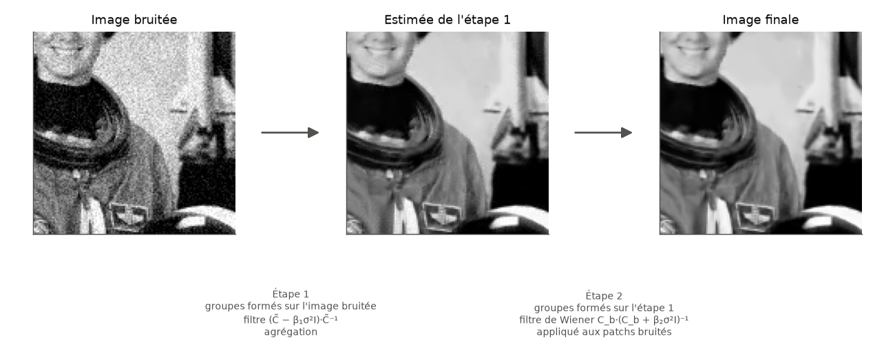
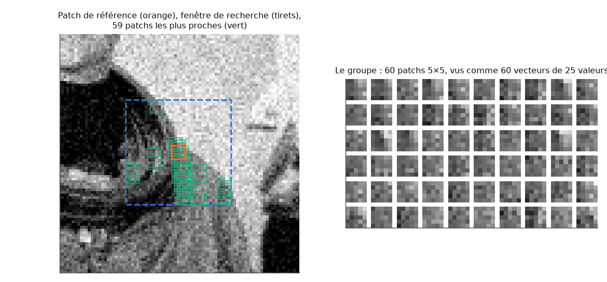
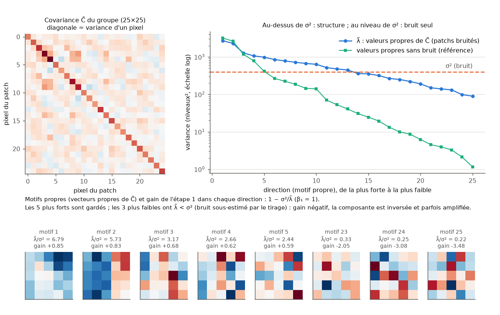
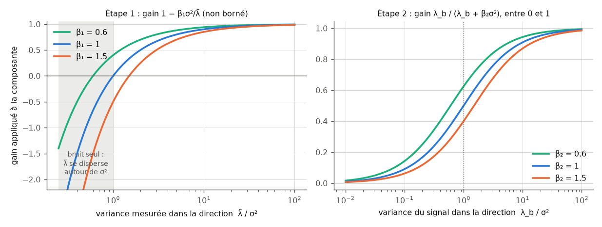
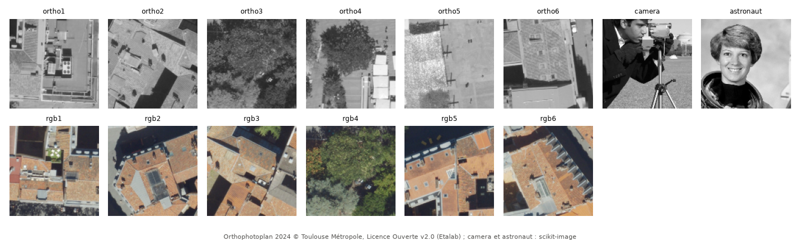
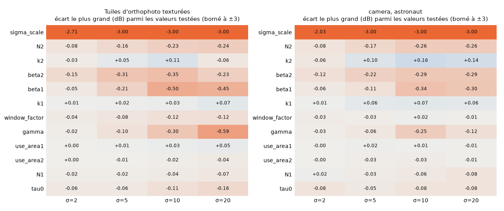
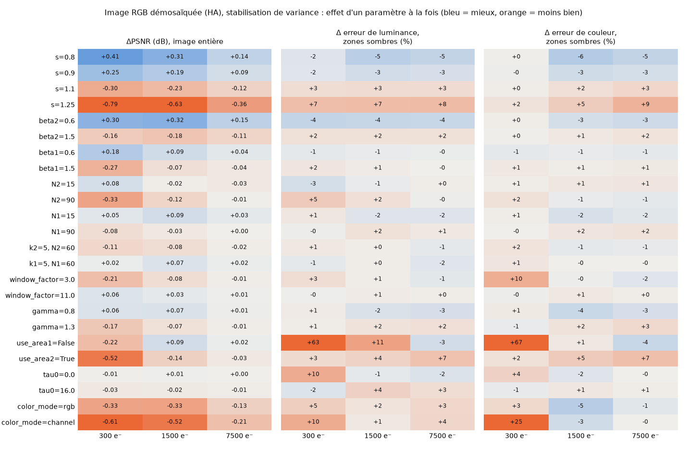
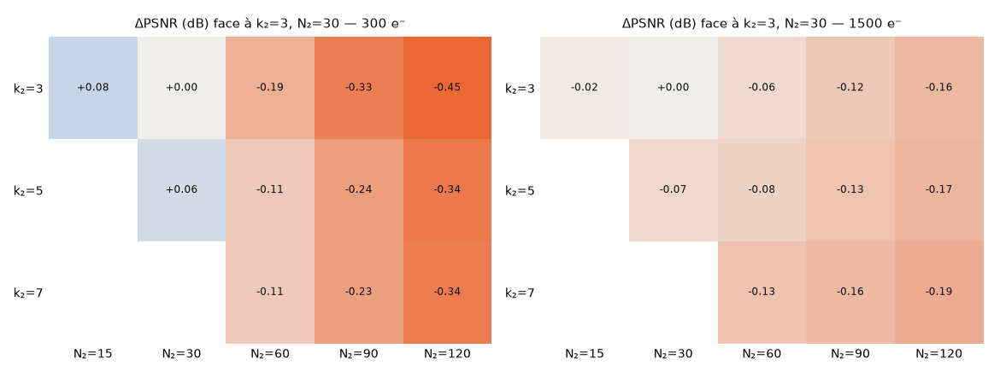

# NL-Bayes — méthode, paramètres et réglage

Ce document rassemble tout ce qui concerne NL-Bayes dans eoqual-denoising :
le principe, les mathématiques, chaque paramètre et son rôle, la place de
σ, la couleur, les deux moteurs, les études de sensibilité et le réglage
par optimisation. Les autres documents y renvoient.

| Méthode du registre | Implémentation | Licence |
|---|---|---|
| `nl_bayes` | réimplémentation numpy écrite depuis l'article (`backends/nl_bayes/native.py`, `vectorized.py`) | MIT |
| `nl_bayes_ipol` | exécutable C++ de l'article IPOL, appelé en composant externe (`backends/nl_bayes/ipol_external.py`, installation : `REFERENCE_TECHNIQUE.md` §3.10) | GPL-3.0+ |

**Références.** A. Buades, M. Lebrun, J.-M. Morel, « A Nonlocal Bayesian
Image Denoising Algorithm », *SIAM J. Imaging Sciences* 6(3), 2013 ;
M. Lebrun, A. Buades, J.-M. Morel, « Implementation of the "Non-Local
Bayes" (NL-Bayes) Image Denoising Algorithm », *Image Processing On Line*
3, 2013 (désigné ci-dessous « l'article »). L'article IPOL est la **seule
source** de `nl_bayes` (aucun code consulté, `THIRD_PARTY_LICENSES.md`
§2.1).

**Plan.** §1 vue d'ensemble ; §2 patchs et groupes ; §3 covariance ;
§4 filtre de Wiener ; §5 les deux étapes ; §6 paramètres ; §7 σ ;
§8 couleur et images démosaïquées ; §9 moteurs ; §10 jeux de données ;
§11 études ; §12 réglage par optimisation ; §13 limites et pistes.

Notations : vecteurs et matrices en gras dans le texte (**Q**, **C**),
formules en blocs de code. σ est l'écart-type du bruit, exprimé sur
l'échelle 0-255 de l'article (§7.2).

## 1. Vue d'ensemble

NL-Bayes débruite une image en deux passes de même structure. Pour chaque
petit carré de l'image (un **patch**), il cherche les patchs qui lui
ressemblent, en déduit un modèle statistique du groupe (une moyenne et une
covariance), et estime chaque patch propre par un **filtre de Wiener**
calculé sur ce modèle. Chaque pixel appartient à plusieurs patchs : ses
estimations sont moyennées.



- **Étape 1** : les groupes sont formés et le modèle est estimé sur
  l'image bruitée. Le résultat (l'**estimée de base**) est déjà débruité
  mais imparfait.
- **Étape 2** : les groupes sont formés et la covariance est estimée sur
  l'estimée de base, bien plus fiable ; le filtre est appliqué aux patchs
  **bruités d'origine**. L'estimée de base ne sert que de guide.

## 2. Patchs, groupes et distance

**Patch.** Un carré de k × k pixels, vu comme un vecteur de d = k²
valeurs. Avec k = 5, d = 25.

**Distance.** La ressemblance entre deux patchs **P** et **Q** est leur
écart quadratique moyen par pixel :

```
δ(P, Q) = (1/d) · Σᵢ (Pᵢ − Qᵢ)²
```

Deux patchs bruités d'un même signal, de bruits indépendants, sont en
moyenne à δ = 2σ². C'est l'ordre de grandeur des distances dans une zone
plate.

**Groupe.** Autour d'un patch de référence, on cherche dans une
**fenêtre de recherche** de n × n positions (n = 7k dans l'article) les
N patchs les plus proches, référence comprise. Le groupe est l'ensemble
de ces N vecteurs.



**Patchs de référence.** Tous les patchs ne sont pas traités comme
références. Le moteur « boucle » suit l'astuce de l'article : un patch déjà
filtré dans un groupe n'est plus pris comme référence (*paste trick*). Le
moteur vectorisé prend une référence tous les `step` pixels (3 par défaut,
§9). Dans les deux cas, tous les patchs d'un groupe reçoivent une
estimation, et chaque pixel en reçoit plusieurs.

## 3. La covariance d'un groupe

### 3.1 Définition

Soit un groupe de N patchs bruités **Q̃**₁ … **Q̃**_N (vecteurs de d
valeurs). Sa **moyenne** et sa **covariance** sont :

```
μ = (1/N) · Σⱼ Q̃ⱼ                                  vecteur de d valeurs : le patch moyen
C̃ = 1/(N−1) · Σⱼ (Q̃ⱼ − μ)(Q̃ⱼ − μ)ᵀ                matrice d × d
```

L'élément C̃[i, l] mesure comment les pixels i et l du patch varient
**ensemble** d'un patch du groupe à l'autre :

- sur la **diagonale**, C̃[i, i] est la variance du pixel i dans le
  groupe ;
- **hors diagonale**, C̃[i, l] > 0 si les deux pixels montent et
  descendent ensemble (même côté d'un contour), < 0 s'ils varient en sens
  opposé, ≈ 0 s'ils sont indépendants.

La covariance résume donc la **forme** des variations à l'intérieur du
groupe : un contour, une texture orientée, un dégradé laissent chacun une
signature propre.

### 3.2 Motifs propres

Une covariance est symétrique : elle se diagonalise dans une base
orthonormée,

```
C̃ = V · Λ · Vᵀ          V = [v₁ … v_d] : motifs propres      Λ = diag(λ₁ ≥ … ≥ λ_d)
```

Chaque vecteur propre v_m est un **motif** de k × k pixels, et sa valeur
propre λ_m est la variance du groupe le long de ce motif : de combien les
patchs du groupe s'écartent du patch moyen « dans la forme v_m ». Les
motifs sont rangés du plus fort au plus faible. Le signal d'un groupe
cohérent se concentre dans quelques motifs ; les autres ne contiennent que
du bruit.

### 3.3 Ce que le bruit ajoute

Un bruit blanc de variance σ², indépendant du signal, ajoute **σ²·I** à la
covariance :

```
C̃ = C_s + σ²·I          C_s : covariance du signal seul
```

σ²·I ne change pas les motifs propres et ajoute σ² à chaque valeur
propre : λ̃_m = λ_s,m + σ². Une direction sans signal a donc une variance
σ², une direction de vraie structure une variance nettement supérieure.
C'est ce qui permet de séparer les deux.

### 3.4 Estimer une covariance avec peu de patchs

La covariance est **estimée** sur N patchs seulement, pour d² / 2
inconnues. Deux conséquences :

- **N doit dépasser d**, sinon C̃ n'est pas inversible. D'où la règle de
  l'article : N = 30, 60, 90 pour k = 3, 5, 7 (d = 9, 25, 49).
- **Les valeurs propres du bruit se dispersent.** Même pour un bruit pur,
  les λ̃ estimés ne valent pas tous σ² : ils s'étalent approximativement
  entre σ²(1 − √(d/N))² et σ²(1 + √(d/N))² (loi de Marchenko-Pastur).
  Avec k = 5 et N = 60, de 0,13σ² à 2,7σ² ; avec k = 3 et N = 30, de
  0,20σ² à 2,4σ². Un motif de bruit peut donc paraître plus fort que σ²
  (il est gardé, §4) ou bien plus faible (son gain devient négatif à
  l'étape 1, §4.3).



Sur cet exemple (σ = 20, k = 5, N = 60), les cinq premiers motifs portent
la structure (contour du scaphandre) ; les valeurs propres de la
référence sans bruit (vert) chutent sous σ² dès le sixième motif, alors
que celles des patchs bruités (bleu) restent autour de σ², dispersées de
0,2σ² à 1,1σ² environ.

## 4. L'estimateur : le filtre de Wiener

### 4.1 Le problème

On observe **Q̃** = **Q** + **n**, et l'on suppose :

- le patch propre **Q** gaussien, de moyenne μ et de covariance C_s
  (modèle du groupe) ;
- le bruit **n** gaussien, de moyenne nulle et de covariance σ²·I,
  indépendant de **Q**.

**Q** et **Q̃** sont alors conjointement gaussiens, avec
Cov(**Q**, **Q̃**) = C_s et Var(**Q̃**) = C_s + σ²·I. La meilleure
estimation de **Q** au sens de l'erreur quadratique moyenne (qui est aussi
la plus probable, le MAP, puisque tout est gaussien) est l'espérance
conditionnelle :

```
Q̂ = E[Q | Q̃] = μ + C_s · (C_s + σ²·I)⁻¹ · (Q̃ − μ)
```

C'est le **filtre de Wiener** : il part du patch moyen du groupe et y
rajoute une part de l'écart observé, d'autant plus grande que cet écart
ressemble à du signal.

### 4.2 Lecture dans la base des motifs

Dans la base propre de C_s, la matrice du filtre est diagonale. Chaque
composante de l'écart, c_m = v_mᵀ(**Q̃** − μ), est multipliée par :

```
g_m = λ_s,m / (λ_s,m + σ²)
```

- motif fort (λ_s,m ≫ σ²) : g_m ≈ 1, la composante est gardée ;
- motif faible (λ_s,m ≪ σ²) : g_m ≈ 0, elle est effacée ;
- λ_s,m = σ² : g_m = 1/2.

Le filtre est donc un **seuillage doux, motif par motif**, réglé par le
rapport signal sur bruit de chaque motif. σ² fixe la frontière entre ce
qui est gardé et ce qui est effacé.

### 4.3 Étape 1 : la covariance du signal est inconnue

À l'étape 1, on ne dispose que de C̃, mesurée sur les patchs bruités. Par
§3.3, C_s ≈ C̃ − σ²·I, et C_s + σ²·I ≈ C̃. Le filtre devient (formule 12
de l'article) :

```
Q̂ = μ + (C̃ − β₁·σ²·I) · C̃⁻¹ · (Q̃ − μ)            gain par motif : g_m = 1 − β₁·σ² / λ̃_m
```

β₁ (1 dans l'article) multiplie la variance de bruit retirée. Ce gain
**n'est pas borné** : quand la dispersion d'estimation (§3.4) donne
λ̃_m < β₁σ², g_m est négatif, et la composante est inversée, voire
amplifiée (g = −3,5 pour λ̃ = 0,22σ² dans l'exemple ci-dessus). L'étape 2
rattrape ce défaut : un essai avec le gain borné à [0, 1] ne change le
résultat final que de −0,04 à +0,26 dB, 0,1 dB au plus en moyenne
(§11.8).

### 4.4 Étape 2 : la covariance vient de l'estimée de base

À l'étape 2, la covariance C_b est calculée sur les patchs de l'estimée
de base, aux mêmes positions que le groupe : elle approche C_s bien mieux
que C̃ − σ²·I. La moyenne μ reste celle des patchs bruités, et le filtre
est appliqué aux patchs **bruités** (formule 15 de l'article) :

```
Q̂ = μ + C_b · (C_b + β₂·σ²·I)⁻¹ · (Q̃ − μ)          gain par motif : g_m = λ_b,m / (λ_b,m + β₂·σ²)
```

Ce gain est toujours compris entre 0 et 1. β₂ vaut 1,2 dans l'article
pour σ < 50 : le filtre suppose un bruit un peu plus fort que σ², ce qui
compense en partie la covariance trop faible de l'estimée de base, déjà
lissée.

### 4.5 Ce que fait β

**β·σ² est la variance de bruit que suppose le filtre.** β > 1 : le filtre
croit le bruit plus fort et efface davantage ; β < 1 : il garde davantage.
Les deux étapes ont chacune leur β parce que ce sont deux filtres
différents (soustraction du bruit d'une covariance bruitée, puis
régularisation d'une covariance presque propre).



### 4.6 Agrégation

Chaque pixel reçoit une estimation de chaque patch filtré qui le
contient. L'image est la moyenne de ces estimations, sans pondération.
L'agrégation réduit encore le bruit et atténue les artefacts de bord de
patch.

## 5. Les deux étapes en détail

### 5.1 Étape 1

Pour chaque patch de référence (patchs k₁ × k₁) :

1. distances δ à tous les patchs de la fenêtre n₁ × n₁, calculées sur
   l'**image bruitée** ;
2. groupe = les N₁ plus proches ;
3. **critère des zones homogènes** (`use_area1`, §5.3) ; s'il est
   satisfait, tous les patchs du groupe prennent la valeur moyenne ;
4. sinon, filtre de l'étape 1 (§4.3) appliqué à tous les patchs du
   groupe ;
5. agrégation : estimée de base.

### 5.2 Étape 2 et seuil τ₀

Pour chaque patch de référence (patchs k₂ × k₂) :

1. distances δ calculées sur l'**estimée de base** ;
2. le groupe n'a plus une taille fixe :

   ```
   d_N = distance du N₂-ième patch le plus proche
   τ   = max(τ₀, d_N)
   groupe = tous les patchs de la fenêtre à distance ≤ τ
   ```

   Sans τ₀, le groupe compte N₂ patchs. τ₀ est un **plancher de
   ressemblance** : dans une zone plate de l'estimée de base, beaucoup plus
   de N₂ patchs sont presque identiques, et τ₀ permet de tous les prendre
   (moyenne et covariance mieux estimées) ;
3. critère des zones homogènes (`use_area2`, désactivé dans l'article) ;
4. filtre de Wiener (§4.4) appliqué aux patchs bruités du groupe ;
5. agrégation : image finale.

τ₀ est un seuil **absolu**, en niveaux² sur l'échelle 0-255 (4 dans
l'article, soit 2 niveaux d'écart moyen). Il ne dépend pas de σ : son
effet relatif change avec le niveau de bruit et avec l'échelle (§7.2).
Comme les distances sont mesurées sur l'estimée de base, dont le bruit
résiduel est faible, τ₀ ne joue que dans les zones à peu près plates.

### 5.3 Critère des zones homogènes

```
s² = variance de toutes les valeurs de pixels du groupe (N × d valeurs)
si  s² ≤ (γ·σ)²   alors   chaque patch du groupe = moyenne scalaire de ces valeurs
```

Si la dispersion du groupe ne dépasse pas celle du bruit, le groupe est
jugé plat et remplacé par sa moyenne : un débruitage maximal, sans
estimer de covariance. γ = 1,05 dans l'article. Le critère est évalué sur
le groupe bruité, aux deux étapes. C'est **le** paramètre des aplats et
des zones sombres (§11.5).

## 6. Les paramètres

### 6.1 Liste complète

| Rôle | `nl_bayes` (argument) | Article | Où il intervient | Effet |
|---|---|---|---|---|
| Niveau de bruit | `sigma` (+ `sigma_scale` en optimisation) | — | β·σ² dans les deux filtres, γσ dans le critère homogène, choix des valeurs par défaut (§6.2) | §7 |
| Dynamique | `data_range` | — | conversion vers l'échelle 0-255 (§7.2) | aucun sur les filtres ; fixe l'échelle de τ₀ et des paliers |
| Taille des patchs | `k1`, `k2` | 5 (gris, σ < 50), 3 (couleur, σ < 20) | dimension d = k² du modèle | petit : peu de structure, groupes plus semblables ; grand : covariance d × d mal estimée |
| Patchs par groupe | `N1`, `N2` | 30 / 60 / 90 pour k = 3 / 5 / 7 | estimation de μ et C ; étape 2 : minimum avant τ₀ | petit : covariance bruitée (§3.4) ; grand : patchs moins semblables |
| Fenêtre de recherche | `n1`, `n2`, ou `window_factor` α (n = α·k) | α = 7 | candidats au groupe | petit : groupes pauvres ; grand : plus lent |
| Atténuation, étape 1 | `beta1` | 1,0 | C̃ − β₁σ²I | > 1 : lisse plus ; < 1 : garde plus |
| Atténuation, étape 2 | `beta2` | 1,2 (σ < 50), 1,0 au-delà | C_b + β₂σ²I | idem |
| Seuil homogène | `gamma` | 1,05 | s² ≤ (γσ)² | grand : aplats lissés, petits détails perdus |
| Critère homogène | `use_area1`, `use_area2` | oui / non | §5.3, par étape | §11.5 |
| Plancher de similarité | `tau0` | 4 niveaux² | τ = max(τ₀, d_N), étape 2 | 0 : groupes limités à N₂ ; grand : patchs dissemblables agrégés |
| Couleur | `color_mode` | `yuv` | §8 | — |
| Pas des références | `step` (moteur vectorisé) | — (astuce « paste ») | nombre de groupes traités | 2 : +0,06 dB, 2× plus lent ; 4 : −0,03 dB, 1,6× plus rapide |
| Exécution | `engine`, `chunk`, `n_threads` | — | moteur et parallélisme | aucun sur le résultat (sauf `engine`, §9) |
| Étape 1 seule | `return_basic` | — | renvoie l'estimée de base | — |

### 6.2 Les valeurs de l'article et σ

L'article donne des **valeurs conseillées** selon σ, sur l'échelle 0-255
(tableau récapitulatif §4.8) : patchs de 3 en couleur jusqu'à σ = 20, de
5 jusqu'à 50, de 7 au-delà ; β₂ = 1,2 sous σ = 50. Ce sont des conseils
établis pour des bruits **forts** : σ = 20 représente 8 % de la
dynamique, un rapport signal sur bruit d'environ 12 en pleine échelle.

En télédétection, σ vaut plutôt 1 à 5 sur 255. Les paliers ne servent
alors jamais : on reste dans la première colonne, réglée pour un bruit
4 à 20 fois plus fort. Les études du §11 mesurent ce que deviennent ces
réglages à faible bruit.

**Dans ce module**, `nl_bayes_parameters` applique ces paliers
automatiquement aux paramètres non fournis. C'est une commodité, pas une
règle de la méthode. Deux précautions :

- en optimisation, un paramètre laissé à son palier (β₂ notamment)
  **saute** quand `sigma_scale` fait passer σ de part et d'autre d'un
  seuil (β₂ passe de 1,2 à 1,0 à σ = 50) : la fonction optimisée devient
  discontinue. Fixer explicitement les paramètres non optimisés ;
- pour une série d'images, fixer explicitement k, N et β plutôt que de
  dépendre de σ estimé image par image.

### 6.3 Dépendances entre paramètres

Appliquées par `resolve_parameters` quand un paramètre est changé seul :

- **N suit k** : N = 30 / 60 / 90 pour k = 3 / 5 / 7, et toujours
  N ≥ k² + 1 (covariance inversible) ;
- **n suit k** : n = α·k (`window_factor` α) ;
- **σ, β et γ agissent ensemble** (§7.3).

## 7. σ dans NL-Bayes

Les généralités sur σ (ce qu'il représente, son estimation, le modèle de
bruit du capteur, la stabilisation de variance, le facteur C après
démosaïçage) sont communes à toutes les méthodes : `REFERENCE_TECHNIQUE.md`
§4 à §6. Ce chapitre ne garde que ce qui est propre à NL-Bayes.

### 7.1 Où σ intervient

À trois endroits seulement, et toujours multiplié par un autre
paramètre :

| Usage | Expression | Étape |
|---|---|---|
| variance de bruit retirée à la covariance | β₁·σ² | 1 |
| variance de bruit du filtre de Wiener | β₂·σ² | 2 |
| seuil du critère des zones homogènes | γ·σ | 1, 2 (si actif) |

S'y ajoute le choix des valeurs par défaut (§6.2), qui n'est pas un usage
dans le calcul. Les distances δ, τ₀ et l'agrégation n'en dépendent pas.

**Le même σ sert aux deux étapes.** C'est correct : les filtres
s'appliquent aux patchs bruités d'origine, dont le bruit vaut σ ; l'estimée
de base ne sert qu'à former les groupes et à estimer C_b.

### 7.2 L'échelle 0-255

σ est fourni dans les unités de l'image, puis converti, avec l'image, sur
l'échelle 0-255 par `data_range` (par défaut le min/max de l'image). Le
calcul reste en flottants : ce n'est pas une quantification 8 bits, mais
le moyen d'appliquer τ₀ et les paliers de l'article, exprimés sur cette
échelle. Les filtres eux-mêmes ne dépendent pas de l'échelle.

Conséquence : « σ = 20 » dans l'article signifie « σ = 20/255 de la
dynamique ». Avec le min/max par défaut, une image peu contrastée voit son
σ relatif gonflé ; pour une série d'images, fixer `data_range` à la
dynamique du capteur (par exemple `(0, 4095)`).

Après stabilisation de variance, σ vaut 1 (ou C) dans le domaine
transformé, dont la dynamique est d'environ 2·√(crête en e⁻) : σ ≈ 13 sur
l'échelle de l'article à 100 e⁻ en crête, 1,3 à 10 000 e⁻.

### 7.3 Redondance entre σ, β et γ

Le calcul ne dépend que des produits β₁σ², β₂σ² et γσ : **trois
grandeurs**. Les réglages qui les modifient sont au nombre de **quatre**
(`sigma_scale` = s, β₁, β₂, γ) : multiplier σ par s revient exactement à
multiplier β₁ et β₂ par s² et γ par s (même image au bit près, vérifié sur
le moteur natif à tailles de patch fixées). **Un réglage est de trop, et
un seul** : il faut en figer un, pas tous.

Figer γ, comme le fait l'espace par défaut, laisse trois réglages
indépendants : s (niveau global, et seul à déplacer γσ), β₁ et β₂ (niveau
relatif de chaque étape). Ce que valent β₁ et β₂ en plus de s est mesuré
au §11.4 et au §11.5 : peu.

Sans critère homogène (γ absent ou inactif), il ne reste que deux
grandeurs (β₁σ², β₂σ²) : s et un seul β suffisent.

## 8. Couleur et images démosaïquées

### 8.1 Trois traitements de la couleur

`color_mode`, pour une image (H, W, 3) de même σ sur les trois canaux :

- **`"yuv"`** (défaut, choix de l'article, §3.3-3.4 et tableau 8) :
  étape 1 dans l'espace Y₀U₀V₀ rendu orthonormé (σ conservé sur chaque
  canal transformé), groupes formés sur Y₀ seul et appliqués à U₀ et V₀,
  filtrage canal par canal ; étape 2 en RGB, groupes formés sur la distance
  moyenne des trois canaux de l'estimée de base (formule 13), **canaux
  filtrés ensemble** : patchs de 3k² valeurs et covariance commune
  (tableau 1 de l'article : deux groupes 3D en tout à l'étape 2, contre deux
  par canal pour BM3D ; filtrés canal par canal jusqu'à la version 0.4.0) ;
- **`"rgb"`** : les deux étapes en RGB, groupes communs aux trois canaux,
  étape 2 à canaux filtrés ensemble ;
- **`"channel"`** : chaque canal débruité indépendamment, comme une image
  en niveaux de gris.

Valeurs par défaut : tableau §4.8 de l'article (patchs de 3 sous σ = 20)
pour `"yuv"` et `"rgb"`, profil niveaux de gris pour `"channel"`.

### 8.2 Image démosaïquée

Le démosaïçage corrèle le bruit entre pixels voisins et entre canaux, et
change sa variance en luminance d'un facteur κ_Y propre au démosaïqueur.
La recette générale (stabiliser avec le modèle du capteur, débruiter avec
σ = C = √κ_Y + 0,2, inverser) est décrite dans `REFERENCE_TECHNIQUE.md`
§6 et eoqual-demosaicing (§11.3).

Ce qui est propre à NL-Bayes : le modèle suppose un bruit **blanc**,
σ²·I. Un bruit corrélé a une covariance Σ_n qui n'est pas diagonale ; il
est fort dans les motifs lisses (basses fréquences) et faible dans les
motifs fins. Retirer σ²·I partout efface trop le grain fin et pas assez
les taches. L'étude du §11.5 le mesure : après Hamilton-Adams, le bruit
démosaïqué est corrélé à 0,4 entre voisins en R et B, et dans les zones
sombres l'erreur de basse fréquence ne diminue presque pas au-delà de
1 500 e⁻, alors que le grain fin diminue. La piste naturelle est de
remplacer σ²·I par Σ_n dans les deux filtres (§13).

## 9. Les deux moteurs

- **`engine="vectorized"`** (défaut) : références sur une **grille** de
  pas `step` (3 par défaut) au lieu de l'astuce « paste », qui est
  séquentielle par nature. Pour un lot de références : extraction des
  fenêtres, distances, sélection des voisins, une matrice de filtrage
  d × d par groupe (A = I − β₁σ²C̃⁻¹ à l'étape 1, A = C_b(C_b + β₂σ²I)⁻¹ à
  l'étape 2) appliquée à tout le groupe par un seul produit, agrégation
  restreinte aux positions touchées. À l'étape 2, les groupes sont traités
  par paquets de taille voisine (médiane 60, jusqu'à la fenêtre entière
  dans les aplats). Les lots sont répartis sur `n_threads` fils
  (min(cœurs, 8) par défaut ; résultat indépendant du nombre de fils).
- **`engine="loop"`** : version fidèle à l'article (astuce « paste »),
  niveaux de gris ou couleur canal par canal.

**Choix non fixés par l'article** (les deux moteurs) : fenêtre de
recherche rabattue à l'intérieur de l'image près des bords ; covariance de
l'étape 2 centrée sur la moyenne des patchs de l'estimée de base ; critère
homogène de l'étape 2 évalué sur le groupe bruité ; covariance singulière
→ patchs laissés inchangés (remarque §3.3 de l'article) ; calcul en
flottants, sans quantification.

**Face à l'exécutable IPOL** (`nl_bayes_ipol`) : à égalité sur 256 × 256
(±0,1 dB), +0,1 à +0,4 dB sur 512 × 256 en niveaux de gris. L'exécutable
IPOL 2013 ne permet pas de régler les paramètres en ligne de commande
(il n'applique pas les patchs de 5 conseillés en gris) et quantifie
l'image sur 8 bits pour l'échange (PNG).

## 10. Jeux de données



| Jeu | Contenu | Bruit | Utilisé par |
|---|---|---|---|
| **Benchmark** | moitié droite (512 × 256) d'« astronaut » (NASA, domaine public), gris et RGB | blanc gaussien σ = 0,05 / 0,1 / 0,2 (image dans [0, 1]), graine 2 | `examples/nl_bayes_benchmark.py`, §11.1-11.2 |
| **τ₀, ajustement** | camera, astronaut, coffee, brick, grass, moon (scikit-image), recadrées à 256 × 256 au plus | gris σ = 5 à 60 ; poisson-gaussien 5 à 400 e⁻ (stabilisé) | `examples/tau0_study.py --images fit`, §11.3 |
| **τ₀, validation** | coins, gravel, rocket, chelsea, text (scikit-image), autre tirage | idem, plus couleur `yuv` σ = 10 à 40 | `examples/tau0_study.py --images validation`, §11.3 |
| **Orthophoto, gris** | 6 tuiles 128 × 128 de luminance, pixels de 20 cm, choisies parmi les plus texturées (toitures en tuiles, frondaisons, dallage) ; plus camera et astronaut sous-échantillonnées, pour comparaison | blanc gaussien σ = 2, 5, 10, 20 (échelle 0-255), 2 tirages | `examples/nl_bayes_sensitivity.py --parts gray`, §11.4 |
| **Orthophoto, RGB démosaïqué** | 6 tuiles RGB 128 × 128 texturées avec 20 à 30 % de zones sombres (ombres portées) | chaîne capteur simulée, ci-dessous | `examples/nl_bayes_sensitivity.py --parts rgb`, §11.5 |

**Orthophoto.** Extrait « place du Capitole » de l'Orthophotoplan 2024 de
Toulouse Métropole (Licence Ouverte v2.0, Etalab), le même que l'exemple
d'eoqual-resampling : 4 096 × 4 096 pixels de 5 cm, moyennés 4 × 4. La
moyenne réduit le bruit propre de l'orthophoto (environ 2 à 6 niveaux
résiduels estimés) et donne des pixels de 20 cm. Ces images sont **plus
texturées** que les images classiques : l'énergie de leurs détails fins
(écart-type du laplacien) vaut 31 à 42, contre 53 à 63 pour camera et
astronaut sous-échantillonnées, mais répartie partout dans l'image au lieu
de quelques contours nets.

**Chaîne capteur simulée (volet RGB).**

1. Image linéaire : l'orthophoto (codée pour l'affichage) est ramenée en
   flux par la puissance 2,2, puis mise à l'échelle d'un flux crête de
   300, 1 500 ou 7 500 e⁻ ; les zones d'ombre deviennent des zones à
   faible signal.
2. Mosaïque de Bayer RGGB : une seule couleur par pixel.
3. Bruit : Poisson (photons) plus bruit de lecture gaussien de 3 e⁻ ;
   gain 1 e⁻/DN.
4. Démosaïçage Hamilton-Adams (eoqual-demosaicing), κ_Y = 1,35, d'où
   C = √1,35 + 0,2 = 1,36.
5. Débruitage NL-Bayes couleur, de deux façons : **avec stabilisation**
   (transformée d'Anscombe généralisée avec le vrai modèle, σ = C, inverse
   exacte) ou **avec un σ global** (σ = C·√(lecture² + signal moyen)).
6. Référence : le démosaïçage de la mosaïque **sans bruit**. Le débruiteur
   ne peut pas corriger l'erreur d'interpolation du démosaïqueur ; comparer
   à l'image RGB vraie la mélangerait au bruit.
7. Mesures dans le **domaine d'affichage** (gamma 1/2,2 sur 0-255), où le
   bruit des zones sombres est visible : écart quadratique moyen de
   l'erreur en **luminance** (moyenne des trois canaux) et en **couleur**
   (écart de chaque canal à cette moyenne), séparément dans les zones
   **sombres** (luminance de référence < 60) et **claires** (> 120), plus
   le PSNR de l'image linéaire.

Point de départ des études : les valeurs de l'article dans leur première
colonne (gris : k = 5, N = 60 ; couleur : k = 3, N = 30 ; α = 7, β₁ = 1,
β₂ = 1,2, γ = 1,05, τ₀ = 4, critère homogène à l'étape 1 seulement),
appliquées partout, sans palier.

## 11. Études

### 11.1 Moteurs (benchmark, niveaux de gris, PSNR en dB)

| Moteur | σ = 0,05 | σ = 0,1 | σ = 0,2 | Temps (σ = 0,1) |
|---|---|---|---|---|
| boucle (article, astuce « paste ») | 36,12 | 32,39 | 28,67 | 2,34 s |
| vectorisé, pas 2 | 36,12 | **32,45** | **28,72** | 2,76 s |
| **vectorisé, pas 3 (défaut)** | 36,10 | 32,42 | 28,68 | **1,38 s** |
| vectorisé, pas 4 | 36,07 | 32,36 | 28,65 | 0,84 s |
| vectorisé, pas 3, un seul fil | 36,10 | 32,42 | 28,68 | 4,03 s |

Au pas 3, le moteur vectorisé égale la boucle pour un temps divisé par
1,7 ; au pas 4, par 2,8 pour −0,03 dB. En un seul fil, il est plus lent
que la boucle : son gain vient du traitement par lots réparti sur
plusieurs cœurs.

### 11.2 Couleur (benchmark, RGB)

| Traitement | PSNR σ = 0,05 | PSNR σ = 0,1 | PSNR σ = 0,2 | SSIM σ = 0,1 | Temps (σ = 0,1) |
|---|---|---|---|---|---|
| *(image bruitée)* | 26,02 | 20,00 | 13,98 | 0,313 | — |
| **`yuv` (article, défaut)** | **37,03** | **33,68** | **30,47** | 0,912 | **1,74 s** |
| `rgb` | 36,71 | 33,31 | 29,82 | **0,914** | 1,89 s |
| `channel` | 35,76 | 32,23 | 28,61 | 0,906 | 4,45 s |
| IPOL C++, canal par canal | 35,41 | 31,82 | 28,15 | 0,872 | 0,34 s |

Mesures de la version 0.4.1 (étape 2 à canaux filtrés ensemble ; jusqu'à
0.4.0, `yuv` donnait 36,24 / 33,07 / 29,85 et `rgb` 36,02 / 32,77 /
29,31). Former les groupes sur la luminance Y₀ (moyenne des trois canaux,
donc moins bruitée) donne des groupes plus fiables, que les canaux de
chrominance partagent, et filtrer les trois canaux ensemble à l'étape 2
exploite leurs corrélations : +1,3 à +1,9 dB sur le canal par canal, pour
un temps divisé par 2,6. `rgb` fait +1,0 à +1,2 dB. La ligne IPOL est
l'exécutable appelé canal par canal (l'appel de `nl_bayes_ipol` ne traite
que les niveaux de gris) : elle ne représente pas son mode couleur.

Reproduire : `python examples/nl_bayes_benchmark.py --out nl_bayes.md`.

### 11.3 τ₀ : une règle fonction de σ, testée et écartée

τ₀ = 4 est un seuil absolu. Une règle relative, τ₀ = c·σ², semblait plus
logique ; elle a été ajustée puis validée (`examples/tau0_study.py`) :

| Étape | Données | τ₀ = 4 : perte moyenne / max face au meilleur τ₀ | τ₀ = 0,005·σ² : perte moyenne / max |
|---|---|---|---|
| Ajustement de c | 6 images × 6 σ (gris) + 6 images × 4 flux (stabilisation) | 0,09 / 0,79 dB | 0,04 / 0,30 dB |
| Validation (c figé) | 5 autres images, autre tirage : gris, stabilisation, couleur `yuv` | 0,02 / 0,10 (gris) ; 0,04 / 0,27 (stab.) ; 0,13 / 0,62 (couleur) | 0,04 / 0,53 ; 0,03 / 0,11 ; 0,16 / 0,74 |

La règle ne tient pas en validation : son gain du premier jeu venait de
deux images (grands aplats, texture régulière). **Le meilleur τ₀ dépend du
contenu de l'image plus que de σ**, et τ₀ = 4 est un compromis robuste.
τ₀ = 0 est à éviter sur des aplats à faible flux (jusqu'à −6,8 dB) : le
plancher est utile.

### 11.4 Sensibilité, niveaux de gris, images texturées

Jeu « orthophoto, gris » (§10) : un paramètre à la fois autour du point
de départ, 2 tirages, `examples/nl_bayes_sensitivity.py --parts gray`.



Écart de PSNR (dB) au point de départ, moyenne des 6 tuiles
d'orthophoto, pour les valeurs les plus parlantes :

| Paramètre | Valeur | σ = 2 | σ = 5 | σ = 10 | σ = 20 |
|---|---|---|---|---|---|
| `sigma_scale` | 0,7 | −0,28 | −0,61 | −0,93 | −1,62 |
| | 0,85 | −0,06 | −0,09 | −0,01 | −0,03 |
| | 1,15 | −0,11 | −0,36 | −0,63 | −0,67 |
| | 1,5 | −0,88 | −1,86 | −2,28 | −1,83 |
| N₂ | 30 | +0,04 | +0,10 | +0,17 | +0,16 |
| | 120 | −0,08 | −0,16 | −0,23 | −0,24 |
| k₂ | 3 | +0,02 | +0,05 | +0,11 | +0,04 |
| β₂ | 0,9 | −0,01 | +0,04 | +0,10 | +0,09 |
| | 2,0 | −0,15 | −0,31 | −0,35 | −0,23 |
| β₁ | 0,75 | −0,01 | −0,01 | +0,08 | +0,11 |
| | 1,5 | −0,04 | −0,21 | −0,50 | −0,45 |
| γ | 1,3 | −0,02 | −0,10 | −0,30 | −0,59 |
| α (fenêtre) | 3 | −0,04 | −0,08 | −0,12 | −0,12 |
| | 11 | +0,01 | +0,03 | +0,06 | +0,06 |
| τ₀ | 0 à 8 | ±0,01 | ±0,01 | ±0,02 | ±0,02 |
| | 32 | −0,06 | −0,06 | −0,11 | −0,16 |
| N₁, `use_area1`, `use_area2` | toutes | ≤ 0,02 | ≤ 0,02 | ≤ 0,04 | ≤ 0,07 |

**Lecture.**

- **`sigma_scale` domine tout** : ±15 % coûtent 0,1 à 0,7 dB, ±30 % jusqu'à
  1,6 dB. L'optimum est proche de 1 quand σ est connu.
- **N₂ vient ensuite** : des groupes de 30 valent mieux que les 60 de
  l'article, et 120 coûte jusqu'à 0,24 dB. Sur ces images texturées, un
  grand groupe mélange des patchs moins semblables.
- **β₁, β₂, γ** ne coûtent que s'ils sont nettement trop grands (sur-lissage)
  ; leurs meilleures valeurs (β < 1) disent la même chose qu'un
  `sigma_scale` un peu inférieur à 1.
- **À σ = 2, le régime de la télédétection, aucun paramètre autre que
  `sigma_scale` ne dépasse 0,05 dB** (sauf des valeurs extrêmes : β₂ = 2,
  N₂ = 120). Le réglage de l'article, établi pour des bruits forts, reste
  bon à faible bruit, à N₂ près.
- **Images texturées et classiques** donnent le même classement ; les
  textures sont plus sensibles à γ trop grand (−0,59 dB contre −0,12 à
  σ = 20) : le critère homogène aplatit alors des zones texturées.

**Croisement `sigma_scale` × β₁ × β₂** (tuiles d'orthophoto, gain sur le
point de départ, en dB) :

| σ | `sigma_scale` seul | `sigma_scale`, β₁, β₂ libres | Meilleur réglage |
|---|---|---|---|
| 2 | 0,00 | 0,00 | départ |
| 5 | 0,00 | +0,04 | β₂ = 0,9 |
| 10 | +0,11 | +0,12 | β₂ = 0,6 |
| 20 | +0,16 | +0,16 | `sigma_scale` = 0,9 |

Libérer β₁ et β₂ en plus de `sigma_scale` rapporte au plus 0,04 dB en
niveaux de gris.

### 11.5 Sensibilité, RGB démosaïqué, zones sombres

> **À refaire.** Les études couleur des §11.5 à §11.7 ont été mesurées
> avant la version 0.4.1, avec l'étape 2 couleur filtrée canal par canal.
> La correction améliore `yuv` de 0,6 à 0,8 dB (§11.2) : les ordres de
> grandeur et le classement des paramètres sont à vérifier.

Jeu « orthophoto, RGB démosaïqué » (§10), `examples/nl_bayes_sensitivity.py
--parts rgb`. Erreurs en niveaux d'affichage (gamma 1/2,2, échelle 0-255),
moyenne des 6 tuiles et de 2 tirages.

**Ce qui reste du bruit après débruitage** (point de départ) :

| Flux crête | 300 e⁻ | 1 500 e⁻ | 7 500 e⁻ |
|---|---|---|---|
| PSNR bruité → débruité, stabilisation | 31,62 → 33,39 | 38,21 → 38,60 | 43,69 → 43,72 |
| Luminance, zones sombres : bruité → stabilisation / σ global | 9,68 → 4,26 / 4,98 | 3,02 → 2,26 / 3,19 | 1,30 → 1,19 / 2,02 |
| Couleur, zones sombres : bruité → stabilisation / σ global | 7,98 → 3,28 / 3,46 | 2,53 → 2,04 / 2,53 | 1,15 → 1,09 / 1,76 |
| Luminance, zones claires : bruité → stabilisation | 5,44 → 4,60 | 2,53 → 2,46 | 1,32 → 1,33 |

Trois constats :

1. **Le gain est faible dès que le flux monte** : +1,8 dB à 300 e⁻,
   +0,4 dB à 1 500 e⁻, rien à 7 500 e⁻. Dans les zones claires, 80 à
   100 % de l'erreur reste.
2. **Le σ global abîme les zones sombres** : à 1 500 et 7 500 e⁻, l'erreur
   des zones sombres après débruitage dépasse celle de l'image bruitée
   (2,02 contre 1,30). Un σ calculé sur le signal moyen est trop grand
   pour les ombres, où le bruit photonique est faible : NL-Bayes y efface
   la texture. **La stabilisation de variance est indispensable** ; la
   suite ne porte que sur elle.
3. **Ce qui reste dans les zones sombres est surtout du bruit de basse
   fréquence** : en séparant l'erreur en grain (détails de 1 à 2 pixels)
   et taches (au-delà, filtre gaussien d'écart-type 2 pixels) :

   | Zones sombres | Grain, luminance | Taches, luminance | Grain, couleur | Taches, couleur |
   |---|---|---|---|---|
   | 300 e⁻ : bruité → débruité | 8,87 → 3,59 | 2,66 → 1,51 | 6,63 → 2,59 | 2,75 → 1,49 |
   | 1 500 e⁻ | 2,81 → 1,98 | 0,62 → 0,61 | 2,12 → 1,66 | 0,85 → 0,79 |
   | 7 500 e⁻ | 1,24 → 1,12 | 0,25 → 0,27 | 1,01 → 0,95 | 0,38 → 0,37 |

   Le grain diminue, les taches ne diminuent presque pas au-delà de
   300 e⁻. Le bruit démosaïqué est corrélé (0,41 entre voisins
   horizontaux en R, 0,20 en G, 0,36 en B) : le modèle σ²·I de NL-Bayes ne
   le reconnaît pas comme du bruit (§8.2).



**Rôle de chaque paramètre** (stabilisation de variance ; ΔPSNR de
l'image entière ; variation de l'erreur des zones sombres, en %, négatif =
mieux) :

| Paramètre | Effet | Zones sombres |
|---|---|---|
| `sigma_scale` | le plus fort : 0,8 gagne +0,14 à +0,41 dB ; 1,25 perd 0,4 à 0,8 dB. L'optimum est **sous** C = √κ_Y + 0,2 : vers 0,8·C à 300 e⁻, 0,6·C ou moins au-delà (en PSNR) | −2 à −6 % à 0,8. À 300 e⁻, 0,6 améliore les zones claires mais dégrade les sombres de 15 % : à faible flux, ombres et zones claires ne voudraient pas le même niveau |
| β₂ | 0,6 gagne +0,15 à +0,32 dB : effet proche de `sigma_scale`, limité à l'étape 2 | −4 % en luminance, −3 % en couleur |
| β₁ | faible (+0,04 à +0,18 dB à 0,6) | ±1 % |
| `use_area1` (critère homogène, étape 1) | le désactiver : −0,22 dB à 300 e⁻, ±0,1 dB au-delà | **+63 % en luminance, +67 % en couleur à 300 e⁻**, +11 % à 1 500 e⁻, −3 % à 7 500 e⁻ : c'est lui qui débruite les ombres à faible flux |
| `use_area2` | l'activer : −0,03 à −0,52 dB | +3 à +7 % |
| γ | 0,8 : +0,01 à +0,07 dB ; 1,3-1,6 : jusqu'à −0,5 dB | 0,8 : −2 à −4 % à 1 500-7 500 e⁻ (moins de textures aplaties) ; 1,6 : jusqu'à +8 % |
| τ₀ | ±0,03 dB (0 à 16) ; n'agit presque que dans les zones sombres et plates (zones claires : moins de 0,5 % jusqu'à τ₀ = 16) | à 300 e⁻, τ₀ = 0 ou 1 : +7 à +10 % ; à 1 500-7 500 e⁻, τ₀ = 0-1 : −1 à −2 %, τ₀ = 16-64 : +3 à +6 %. τ₀ = 4 est le bon compromis |
| N₂ | 15 : +0,08 dB à 300 e⁻ ; 90 : −0,33 dB | 15 : −3 % à 300 e⁻ ; 90 : +5 % |
| N₁ | ≤ 0,1 dB | ±2 % |
| k₁, k₂ | k₂ = 5-7 : −0,02 à −0,23 dB ; k₁ = 5-7 : ≤ +0,1 dB | ±1 à 4 % |
| α (fenêtre) | 3 : −0,21 dB à 300 e⁻ ; 11 : +0,06 dB | 3 : +10 % en couleur à 300 e⁻ |
| `color_mode` | `yuv` (défaut) le meilleur : `rgb` −0,13 à −0,33 dB, `channel` −0,2 à −0,6 dB | `rgb` réduit la couleur des zones sombres à 1 500 e⁻ (−5 %) mais dégrade la luminance |

**Croisements.**



- **N₂ × k₂** : pas d'interaction notable. Le meilleur reste un petit
  patch et un petit groupe (k₂ = 3 avec N₂ = 15-30, ou k₂ = 5 avec
  N₂ = 30) ; augmenter N₂ coûte autant quel que soit k₂.
- **`sigma_scale` × N₂** : l'optimum de `sigma_scale` (0,8) ne dépend pas
  de N₂ ; à `sigma_scale` = 0,8, N₂ = 15-30 reste le meilleur.
- **γ × `use_area2`** : activer le critère à l'étape 2 dégrade tout,
  d'autant plus que γ est grand (+22 % dans les zones sombres à γ = 1,6).
- **β₁ × β₂** : le meilleur couple (0,6 ; 0,6) gagne +0,16 à +0,43 dB,
  autant que `sigma_scale` = 0,8 seul (+0,14 à +0,41 dB) : β₁ et β₂
  n'apportent presque rien au-delà du niveau global.

**Conclusion pour les zones sombres.** À faible flux (300 e⁻), deux
paramètres comptent : le critère des zones homogènes de l'étape 1
(indispensable) et τ₀ (ne pas descendre sous 4). Au-delà, aucun paramètre
ne réduit l'erreur des zones sombres de plus de 6 % : ce qui reste est le
bruit corrélé du démosaïçage, que le modèle σ²·I ne traite pas (§13).

### 11.6 σ et β₂ après stabilisation

Après la stabilisation de variance, le bruit d'une image **brute** a un
écart-type 1 : σ est connu, il n'y a rien à compenser. Après
démosaïçage, le bruit stabilisé de la luminance vaut √κ_Y (1,16 pour
Hamilton-Adams, κ_Y = 1,35). La recette générale (eoqual-demosaicing,
§11.4, réglages de l'article) donne σ = C = √κ_Y + 0,2 (1,36). Question :
quel σ et quel β₂ choisir quand β₂ est libre, β₂ étant multiplié par le
même σ² que β₁ ?

`examples/nl_bayes_sensitivity.py --parts sigma_beta` : même chaîne qu'au
§11.5, stabilisation, σ transmis ∈ {0,8 ; 0,95 ; 1,1 ; 1,25 ; 1,4} ×
β₁ ∈ {0,6 ; 0,8 ; 1} × β₂ ∈ {0,4 ; …; 1,2}, 6 tuiles, 2 tirages. Gain de
PSNR (dB) par rapport au réglage de l'article (σ = 1,36, β₁ = 1,
β₂ = 1,2), β₁ = 1 :

| σ transmis | β₂ = 0,4 | 0,6 | 0,8 | 1,0 | 1,2 |
|---|---|---|---|---|---|
| 300 e⁻ : 0,95 | +0,02 | +0,24 | +0,35 | +0,42 | **+0,45** |
| 1,1 | +0,26 | +0,40 | **+0,43** | **+0,43** | +0,40 |
| 1,25 | +0,36 | **+0,39** | +0,35 | +0,29 | +0,21 |
| 1 500 e⁻ : 0,95 | +0,21 | +0,31 | +0,36 | **+0,37** | **+0,37** |
| 1,1 | +0,30 | +0,36 | **+0,37** | +0,35 | +0,31 |
| 1,25 | +0,35 | **+0,36** | +0,31 | +0,24 | +0,16 |
| 7 500 e⁻ : 0,95 | +0,10 | +0,13 | +0,15 | **+0,16** | **+0,16** |
| 1,1 | +0,13 | +0,16 | **+0,17** | +0,16 | +0,14 |
| 1,25 | +0,15 | **+0,16** | +0,15 | +0,12 | +0,08 |

Constats :

1. **Une crête** : le résultat dépend surtout de β₂·σ². Le long de la
   crête (σ = 0,95 avec β₂ = 1,2 ; σ = 1,1 avec β₂ = 0,8-1 ; σ = 1,25
   avec β₂ = 0,6), le PSNR varie de 0,06 dB au plus. Tous ces points
   gagnent 0,4 dB à 300 e⁻ sur le réglage de l'article.
2. **Les zones sombres départagent la crête à faible flux.** Erreur de
   luminance des zones sombres à 300 e⁻ (β₁ = 1) :

   | σ, β₂ | 0,8 ; 1,2 | 0,95 ; 1,2 | 1,1 ; 0,8 | 1,25 ; 0,6 |
   |---|---|---|---|---|
   | ΔPSNR | +0,29 dB | +0,45 dB | +0,43 dB | +0,39 dB |
   | zones sombres, luminance | +14 % | +2 % | −3 % | −5 % |

   À PSNR presque égal, un σ plus haut avec β₂ plus bas vaut mieux dans
   les ombres : σ fixe aussi le seuil des zones homogènes γσ, que β₂ ne
   touche pas. Baisser σ sous le niveau réel du bruit fait échouer le
   critère homogène sur des ombres pourtant plates. À 1 500 et 7 500 e⁻,
   les points de la crête se valent (±1 %).
3. **β₁ compte peu** : près de l'optimum, β₁ = 0,6, 0,8 ou 1 changent le
   PSNR de 0,05 dB au plus (table complète dans le rapport de l'étude).
4. **Libérer β₂ en plus de σ** ne gagne que 0,01 à 0,03 dB en PSNR ; son
   intérêt est de laisser σ au niveau physique du bruit, ce qui garde γσ à
   sa place (constat 2).

**Règle** : après stabilisation, `sigma_scale` au niveau réel du bruit,
1 sur une image brute, ≈ √κ_Y sur une image démosaïquée (1,1 mesuré pour
Hamilton-Adams, √κ_Y = 1,16) ; β₁ = 1 ; **β₂ = 0,8 à 1,0** au lieu de
1,2. Sur ces tuiles, C = √κ_Y + 0,2 = 1,36 est trop haut quel que soit
β₂ (0,4 dB perdus à 300 e⁻) : la règle C a été établie sur d'autres
images (eoqual-demosaicing §11.4), à vérifier sur les images du capteur
visé.

### 11.7 N₂ et zones plates : taille réelle des groupes

Réduire N₂ améliore le résultat sur ces images (§11.4, §11.5), ce qui
semble aller contre le débruitage des zones homogènes, où plus de patchs
moyennés donneraient moins de bruit. Ce n'est pas contradictoire, pour
deux raisons :

- **À l'étape 1, les zones plates ne passent pas par N** : leur groupe
  est remplacé par sa moyenne (critère homogène, §5.3).
- **À l'étape 2, N₂ n'est qu'un minimum** : le groupe contient tous les
  patchs à distance ≤ max(τ₀, d_N₂) (§5.2), distance mesurée sur
  l'estimée de base. Dans une zone plate, l'estimée de base est lisse, les
  distances sont sous τ₀, et le groupe dépasse N₂.

Mesure (`--parts groups`) : taille moyenne des groupes de l'étape 2 sur
le canal Y₀ du domaine stabilisé (k₂ = 3, fenêtre 21 × 21, τ₀ = 4).

| N₂ | Zones claires : taille | part agrandie | Zones sombres : taille | part agrandie |
|---|---|---|---|---|
| 15 | 15,1-15,4 | 1-2 % | 44-49 | 37-43 % |
| 30 | 30,0-30,2 | ≤ 1 % | 53-58 | 31-36 % |
| 60 | 60,0-60,1 | 0 % | 74-79 | 23-26 % |
| 90 | 90,0 | 0 % | 98-102 | 16-19 % |

(plages sur les trois flux). Dans les zones sombres, plus d'un groupe sur
trois est agrandi par τ₀ quand N₂ = 15-30 : là où l'ombre est vraiment
plate, le groupe reste grand. N₂ ne limite le groupe que là où l'estimée
de base montre une structure. Dans ce cas, un grand groupe mêle des patchs
de structures différentes, la covariance moyenne ces structures et le
filtre les atténue. C'est ce qui coûte, dans les ombres texturées comme
dans les zones claires : à 300 e⁻, N₂ = 90 dégrade la luminance de +5,5 %
en zones sombres et de +5,9 % en zones claires (§11.5). L'effet disparaît
à fort flux (≤ 1 % à 7 500 e⁻). N₂ n'est donc pas un paramètre des zones
sombres : ce sont τ₀ et le critère homogène qui y règlent la taille des
groupes.

### 11.8 Gain de l'étape 1 borné

Essai exploratoire (moteur vectorisé modifié en dehors du module, tuiles
gris du §11.4) : gain de l'étape 1 borné à [0, 1] dans la base propre,
au lieu de la formule non bornée de l'article (§4.3).

| Images | σ = 2 | σ = 5 | σ = 10 | σ = 20 |
|---|---|---|---|---|
| estimée de base, orthophoto | −0,02 | −0,07 | −0,06 | +0,08 |
| image finale, orthophoto | 0,00 | 0,00 | +0,05 | +0,10 |
| image finale, camera et astronaut | +0,01 | −0,01 | +0,03 | +0,02 |

Écarts moyens en dB. Le gain négatif dégrade localement l'estimée de base,
mais l'étape 2, qui refiltre les patchs bruités d'origine, efface presque
tout l'effet. La formule de l'article est conservée.

## 12. Réglage par optimisation

### 12.1 Ce qu'il faut régler

Classement tiré des §11.3 à §11.7, du plus utile au moins utile :

| Rang | Paramètre | Pourquoi | Domaine conseillé |
|---|---|---|---|
| 1 | `sigma_scale` | seul paramètre à effet fort partout (jusqu'à 1 dB et plus) ; compense un σ mal connu, ou donne le niveau réel du bruit après stabilisation | [0,5 ; 2,5] ; départ 1 (image brute ou σ connu), √κ_Y à C après démosaïçage |
| 2 | β₂, avec β₁ = 1 fixé | règle l'étape 2 par rapport à l'étape 1 ; permet de garder σ au niveau réel du bruit (§11.6) | [0,4 ; 1,5], départ 1,2 (article) ; optimum mesuré 0,8-1,0 |
| 3 | N₂ | groupes plus petits que l'article sur images texturées ; les zones plates gardent de grands groupes par τ₀ (§11.7) | [15 ; 90], porté à k₂² + 1 au moins |
| — | `use_area1` | indispensable à faible flux ; ne pas l'optimiser, le garder actif | fixe : oui |
| — | β₁, γ, τ₀, α, `use_area2` | effets faibles, ou redondants avec `sigma_scale` | fixes : 1 ; 1,05 ; 4 ; 7 ; non |
| — | k₁, k₂, N₁ | effets faibles ; la règle de l'article dépend de la couleur (5 en gris, 3 en couleur à faible bruit) | règle de l'article |

Trois dimensions au lieu de sept : 15 à 25 évaluations suffisent. Les
paramètres non optimisés sont fixés explicitement, sauf k₁, k₂ et N₁ :
aucun palier de β ne bascule quand `sigma_scale` fait varier σ (§6.2).
Les paliers de taille de patch restent (σ = 20 et 50 sur [0, 255]), mais
ils ne concernent que les bruits forts.

**Valeurs à retenir après stabilisation de variance** (σ = 1 transmis,
multiplié par `sigma_scale`) : `sigma_scale` = 1 sur image brute,
≈ √κ_Y sur image démosaïquée ; β₁ = 1 ; β₂ = 0,8 à 1,0. β₂ multiplie le
même σ² que β₁ : c'est un rapport entre les deux étapes, à `sigma_scale`
donné. Si `sigma_scale` monte, β₂ optimal baisse (crête β₂·σ² ≈
constante, §11.6).

### 12.2 L'espace par défaut

`optimization/spaces/nl_bayes.jsonc` (2026-11-18) optimise `sigma_scale`,
β₂ et N₂ ; il part de l'article (`sigma_scale` = 1, β₂ = 1,2) avec
N₂ = 30, qui est la valeur de l'article en couleur et la moitié de celle
du gris (60 à k₂ = 5). β₁, γ, τ₀, α, `use_area1` et `use_area2` sont
dans `fixed`. L'espace précédent (7 dimensions : `sigma_scale`, k₁, k₂,
α, τ₀, `use_area1`, `use_area2`) optimisait surtout des paramètres à
effet faible, et laissait de côté β₂ et N₂.

### 12.3 Précautions

- **Valider sur une autre image** que celle du réglage : sur le benchmark,
  un réglage peut gagner 0,15 dB sur l'image de réglage et 0,02 dB
  seulement sur une autre (`BENCHMARK.md` §3).
- **Images de télédétection** : régler sur des images du capteur, au bon
  niveau de flux ; le classement des paramètres change entre faible et
  fort flux (§11.5).
- Le réglage de σ et du modèle de bruit (stabilisation, facteur C) suit
  `OPTIMISATION.md` §2.

## 13. Limites et pistes

- **Bruit corrélé** (image démosaïquée) : remplacer σ²·I par la
  covariance du bruit Σ_n dans les deux filtres (C̃ − β₁Σ_n, puis
  C_b + β₂Σ_n), Σ_n mesurée une fois par démosaïqueur (bruit pur, comme
  κ_Y). C'est la piste la plus prometteuse contre les taches de couleur
  des zones sombres (§8.2, §11.5) ; voir aussi `REFERENCE_TECHNIQUE.md`
  §10.1.
- **Bruit dépendant du signal sans stabilisation** : un σ par groupe,
  calculé à partir du modèle du capteur et de la moyenne du groupe, au
  lieu d'un σ global ; l'étude du §11.5 montre que le σ global est la
  première cause d'erreur dans les zones sombres.
- **Vitesse** : numpy sur CPU ; un portage PyTorch (GPU) serait le
  prochain gain.
