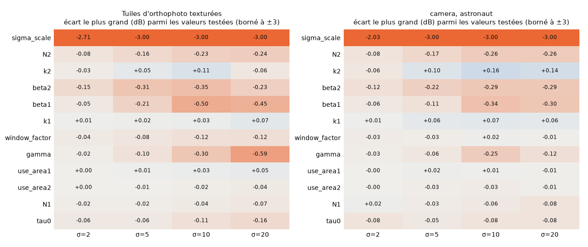
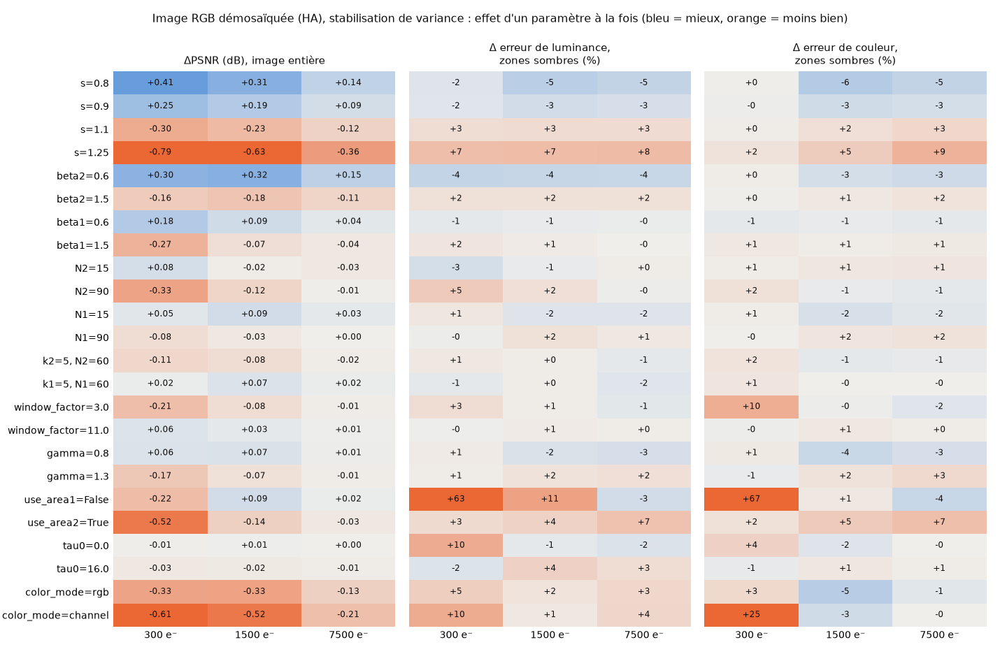
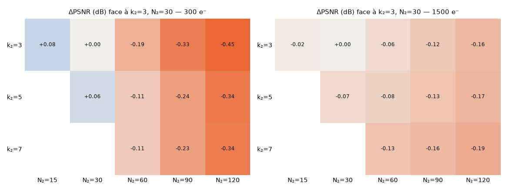

# NL-Bayes : études

## 11. Études

### 11.1 Moteurs (benchmark, niveaux de gris, PSNR en dB)

| Moteur | σ = 0,05 | σ = 0,1 | σ = 0,2 | Temps (σ = 0,1) |
|---|---|---|---|---|
| boucle (article, astuce « paste ») | 36,12 | 32,39 | 28,67 | 2,34 s |
| vectorisé, pas 2 | 36,12 | **32,45** | **28,72** | 2,76 s |
| **vectorisé, pas 3 (défaut)** | 36,10 | 32,42 | 28,68 | **1,38 s** |
| vectorisé, pas 4 | 36,07 | 32,36 | 28,65 | 0,84 s |
| vectorisé, pas 3, un seul fil | 36,10 | 32,42 | 28,68 | 4,03 s |

Au pas 3, le moteur vectorisé égale la boucle pour un temps divisé par
1,7 ; au pas 4, par 2,8 pour −0,03 dB. En un seul fil, il est plus lent
que la boucle : son gain vient du traitement par lots réparti sur
plusieurs cœurs.

### 11.2 Couleur (benchmark, RGB)

| Traitement | PSNR σ = 0,05 | PSNR σ = 0,1 | PSNR σ = 0,2 | SSIM σ = 0,1 | Temps (σ = 0,1) |
|---|---|---|---|---|---|
| *(image bruitée)* | 26,02 | 20,00 | 13,98 | 0,313 | — |
| **`yuv` (article, défaut)** | **37,03** | **33,68** | **30,47** | 0,912 | **1,74 s** |
| `rgb` | 36,71 | 33,31 | 29,82 | **0,914** | 1,89 s |
| `channel` | 35,76 | 32,23 | 28,61 | 0,906 | 4,45 s |
| IPOL C++, canal par canal | 35,41 | 31,82 | 28,15 | 0,872 | 0,34 s |

Mesures avec l'étape 2 à canaux filtrés ensemble (canal par canal, `yuv`
donne 36,24 / 33,07 / 29,85 et `rgb` 36,02 / 32,77 / 29,31). Former les groupes sur la luminance Y₀ (moyenne des trois canaux,
donc moins bruitée) donne des groupes plus fiables, que les canaux de
chrominance partagent, et filtrer les trois canaux ensemble à l'étape 2
exploite leurs corrélations : +1,3 à +1,9 dB sur le canal par canal, pour
un temps divisé par 2,6. `rgb` fait +1,0 à +1,2 dB. La ligne IPOL est
l'exécutable appelé canal par canal (l'appel de `nl_bayes_ipol` ne traite
que les niveaux de gris) : elle ne représente pas son mode couleur.

Reproduire : `python examples/nl_bayes_benchmark.py --out nl_bayes.md`.

### 11.3 τ₀ : une règle fonction de σ, testée et écartée

τ₀ = 4 est un seuil absolu. Une règle relative, τ₀ = c·σ², semblait plus
logique ; elle a été ajustée puis validée (`examples/tau0_study.py`) :

| Étape | Données | τ₀ = 4 : perte moyenne / max face au meilleur τ₀ | τ₀ = 0,005·σ² : perte moyenne / max |
|---|---|---|---|
| Ajustement de c | 6 images × 6 σ (gris) + 6 images × 4 flux (stabilisation) | 0,09 / 0,79 dB | 0,04 / 0,30 dB |
| Validation (c figé) | 5 autres images, autre tirage : gris, stabilisation, couleur `yuv` | 0,02 / 0,10 (gris) ; 0,04 / 0,27 (stab.) ; 0,13 / 0,62 (couleur) | 0,04 / 0,53 ; 0,03 / 0,11 ; 0,16 / 0,74 |

La règle ne tient pas en validation : son gain du premier jeu venait de
deux images (grands aplats, texture régulière). **Le meilleur τ₀ dépend du
contenu de l'image plus que de σ**, et τ₀ = 4 est un compromis robuste.
τ₀ = 0 est à éviter sur des aplats à faible flux (jusqu'à −6,8 dB) : le
plancher est utile.

### 11.4 Sensibilité, niveaux de gris, images texturées

Jeu « orthophoto, gris » ([§10](parametres.md#10-jeux-de-données)) : un paramètre à la fois autour du point
de départ, 2 tirages, `examples/nl_bayes_sensitivity.py --parts gray`.

Écart de PSNR (dB) au point de départ, moyenne des 6 tuiles
d'orthophoto, pour les valeurs les plus parlantes :

| Paramètre | Valeur | σ = 2 | σ = 5 | σ = 10 | σ = 20 |
|---|---|---|---|---|---|
| `sigma_scale` | 0,7 | −0,28 | −0,61 | −0,93 | −1,62 |
| | 0,85 | −0,06 | −0,09 | −0,01 | −0,03 |
| | 1,15 | −0,11 | −0,36 | −0,63 | −0,67 |
| | 1,5 | −0,88 | −1,86 | −2,28 | −1,83 |
| N₂ | 30 | +0,04 | +0,10 | +0,17 | +0,16 |
| | 120 | −0,08 | −0,16 | −0,23 | −0,24 |
| k₂ | 3 | +0,02 | +0,05 | +0,11 | +0,04 |
| β₂ | 0,9 | −0,01 | +0,04 | +0,10 | +0,09 |
| | 2,0 | −0,15 | −0,31 | −0,35 | −0,23 |
| β₁ | 0,75 | −0,01 | −0,01 | +0,08 | +0,11 |
| | 1,5 | −0,04 | −0,21 | −0,50 | −0,45 |
| γ | 1,3 | −0,02 | −0,10 | −0,30 | −0,59 |
| α (fenêtre) | 3 | −0,04 | −0,08 | −0,12 | −0,12 |
| | 11 | +0,01 | +0,03 | +0,06 | +0,06 |
| τ₀ | 0 à 8 | ±0,01 | ±0,01 | ±0,02 | ±0,02 |
| | 32 | −0,06 | −0,06 | −0,11 | −0,16 |
| N₁, `use_area1`, `use_area2` | toutes | ≤ 0,02 | ≤ 0,02 | ≤ 0,04 | ≤ 0,07 |

**Lecture.**

- **`sigma_scale` domine tout** : ±15 % coûtent 0,1 à 0,7 dB, ±30 % jusqu'à
  1,6 dB. L'optimum est proche de 1 quand σ est connu.
- **N₂ vient ensuite** : des groupes de 30 valent mieux que les 60 de
  l'article, et 120 coûte jusqu'à 0,24 dB. Sur ces images texturées, un
  grand groupe mélange des patchs moins semblables.
- **β₁, β₂, γ** ne coûtent que s'ils sont nettement trop grands (sur-lissage)
  ; leurs meilleures valeurs (β < 1) disent la même chose qu'un
  `sigma_scale` un peu inférieur à 1.
- **À σ = 2, le régime de la télédétection, aucun paramètre autre que
  `sigma_scale` ne dépasse 0,05 dB** (sauf des valeurs extrêmes : β₂ = 2,
  N₂ = 120). Le réglage de l'article, établi pour des bruits forts, reste
  bon à faible bruit, à N₂ près.
- **Images texturées et classiques** donnent le même classement ; les
  textures sont plus sensibles à γ trop grand (−0,59 dB contre −0,12 à
  σ = 20) : le critère homogène aplatit alors des zones texturées.

**Croisement `sigma_scale` × β₁ × β₂** (tuiles d'orthophoto, gain sur le
point de départ, en dB) :

| σ | `sigma_scale` seul | `sigma_scale`, β₁, β₂ libres | Meilleur réglage |
|---|---|---|---|
| 2 | 0,00 | 0,00 | départ |
| 5 | 0,00 | +0,04 | β₂ = 0,9 |
| 10 | +0,11 | +0,12 | β₂ = 0,6 |
| 20 | +0,16 | +0,16 | `sigma_scale` = 0,9 |

Libérer β₁ et β₂ en plus de `sigma_scale` rapporte au plus 0,04 dB en
niveaux de gris.

### 11.5 Sensibilité, RGB démosaïqué, zones sombres

> **À lire avec le §11.8.** Les tableaux détaillés des §11.5 à §11.7
> ont été mesurés avec une étape 2 couleur canal par canal et contre le
> démosaïçage sans bruit. Remesurés avec les canaux filtrés ensemble, et
> aussi contre la vraie image, ils confirment le rôle des paramètres (critère homogène
> indispensable à faible flux, rôle de τ₀ et de N₂), mais pas la valeur de
> σ et de β₂ conseillée au §11.6 : voir §11.8.

Jeu « orthophoto, RGB démosaïqué » ([§10](parametres.md#10-jeux-de-données)), `examples/nl_bayes_sensitivity.py
--parts rgb`. Erreurs en niveaux d'affichage (gamma 1/2,2, échelle 0-255),
moyenne des 6 tuiles et de 2 tirages.

**Ce qui reste du bruit après débruitage** (point de départ) :

| Flux crête | 300 e⁻ | 1 500 e⁻ | 7 500 e⁻ |
|---|---|---|---|
| PSNR bruité → débruité, stabilisation | 31,62 → 33,39 | 38,21 → 38,60 | 43,69 → 43,72 |
| Luminance, zones sombres : bruité → stabilisation / σ global | 9,68 → 4,26 / 4,98 | 3,02 → 2,26 / 3,19 | 1,30 → 1,19 / 2,02 |
| Couleur, zones sombres : bruité → stabilisation / σ global | 7,98 → 3,28 / 3,46 | 2,53 → 2,04 / 2,53 | 1,15 → 1,09 / 1,76 |
| Luminance, zones claires : bruité → stabilisation | 5,44 → 4,60 | 2,53 → 2,46 | 1,32 → 1,33 |

Trois constats :

1. **Le gain est faible dès que le flux monte** : +1,8 dB à 300 e⁻,
   +0,4 dB à 1 500 e⁻, rien à 7 500 e⁻. Dans les zones claires, 80 à
   100 % de l'erreur reste.
2. **Le σ global abîme les zones sombres** : à 1 500 et 7 500 e⁻, l'erreur
   des zones sombres après débruitage dépasse celle de l'image bruitée
   (2,02 contre 1,30). Un σ calculé sur le signal moyen est trop grand
   pour les ombres, où le bruit photonique est faible : NL-Bayes y efface
   la texture. **La stabilisation de variance est indispensable** ; la
   suite ne porte que sur elle.
3. **Ce qui reste dans les zones sombres est surtout du bruit de basse
   fréquence** : en séparant l'erreur en grain (détails de 1 à 2 pixels)
   et taches (au-delà, filtre gaussien d'écart-type 2 pixels) :

   | Zones sombres | Grain, luminance | Taches, luminance | Grain, couleur | Taches, couleur |
   |---|---|---|---|---|
   | 300 e⁻ : bruité → débruité | 8,87 → 3,59 | 2,66 → 1,51 | 6,63 → 2,59 | 2,75 → 1,49 |
   | 1 500 e⁻ | 2,81 → 1,98 | 0,62 → 0,61 | 2,12 → 1,66 | 0,85 → 0,79 |
   | 7 500 e⁻ | 1,24 → 1,12 | 0,25 → 0,27 | 1,01 → 0,95 | 0,38 → 0,37 |

   Le grain diminue, les taches ne diminuent presque pas au-delà de
   300 e⁻. Le bruit démosaïqué est corrélé (0,41 entre voisins
   horizontaux en R, 0,20 en G, 0,36 en B) : le modèle σ²·I de NL-Bayes ne
   le reconnaît pas comme du bruit ([§8.2](parametres.md#82-image-démosaïquée)).

**Rôle de chaque paramètre** (stabilisation de variance ; ΔPSNR de
l'image entière ; variation de l'erreur des zones sombres, en %, négatif =
mieux) :

| Paramètre | Effet | Zones sombres |
|---|---|---|
| `sigma_scale` | le plus fort : 0,8 gagne +0,14 à +0,41 dB ; 1,25 perd 0,4 à 0,8 dB. L'optimum est **sous** C = √κ_Y + 0,2 : vers 0,8·C à 300 e⁻, 0,6·C ou moins au-delà (en PSNR) | −2 à −6 % à 0,8. À 300 e⁻, 0,6 améliore les zones claires mais dégrade les sombres de 15 % : à faible flux, ombres et zones claires ne voudraient pas le même niveau |
| β₂ | 0,6 gagne +0,15 à +0,32 dB : effet proche de `sigma_scale`, limité à l'étape 2 | −4 % en luminance, −3 % en couleur |
| β₁ | faible (+0,04 à +0,18 dB à 0,6) | ±1 % |
| `use_area1` (critère homogène, étape 1) | le désactiver : −0,22 dB à 300 e⁻, ±0,1 dB au-delà | **+63 % en luminance, +67 % en couleur à 300 e⁻**, +11 % à 1 500 e⁻, −3 % à 7 500 e⁻ : c'est lui qui débruite les ombres à faible flux |
| `use_area2` | l'activer : −0,03 à −0,52 dB | +3 à +7 % |
| γ | 0,8 : +0,01 à +0,07 dB ; 1,3-1,6 : jusqu'à −0,5 dB | 0,8 : −2 à −4 % à 1 500-7 500 e⁻ (moins de textures aplaties) ; 1,6 : jusqu'à +8 % |
| τ₀ | ±0,03 dB (0 à 16) ; n'agit presque que dans les zones sombres et plates (zones claires : moins de 0,5 % jusqu'à τ₀ = 16) | à 300 e⁻, τ₀ = 0 ou 1 : +7 à +10 % ; à 1 500-7 500 e⁻, τ₀ = 0-1 : −1 à −2 %, τ₀ = 16-64 : +3 à +6 %. τ₀ = 4 est le bon compromis |
| N₂ | 15 : +0,08 dB à 300 e⁻ ; 90 : −0,33 dB | 15 : −3 % à 300 e⁻ ; 90 : +5 % |
| N₁ | ≤ 0,1 dB | ±2 % |
| k₁, k₂ | k₂ = 5-7 : −0,02 à −0,23 dB ; k₁ = 5-7 : ≤ +0,1 dB | ±1 à 4 % |
| α (fenêtre) | 3 : −0,21 dB à 300 e⁻ ; 11 : +0,06 dB | 3 : +10 % en couleur à 300 e⁻ |
| `color_mode` | `yuv` (défaut) le meilleur : `rgb` −0,13 à −0,33 dB, `channel` −0,2 à −0,6 dB | `rgb` réduit la couleur des zones sombres à 1 500 e⁻ (−5 %) mais dégrade la luminance |

**Croisements.**

- **N₂ × k₂** : pas d'interaction notable. Le meilleur reste un petit
  patch et un petit groupe (k₂ = 3 avec N₂ = 15-30, ou k₂ = 5 avec
  N₂ = 30) ; augmenter N₂ coûte autant quel que soit k₂.
- **`sigma_scale` × N₂** : l'optimum de `sigma_scale` (0,8) ne dépend pas
  de N₂ ; à `sigma_scale` = 0,8, N₂ = 15-30 reste le meilleur.
- **γ × `use_area2`** : activer le critère à l'étape 2 dégrade tout,
  d'autant plus que γ est grand (+22 % dans les zones sombres à γ = 1,6).
- **β₁ × β₂** : le meilleur couple (0,6 ; 0,6) gagne +0,16 à +0,43 dB,
  autant que `sigma_scale` = 0,8 seul (+0,14 à +0,41 dB) : β₁ et β₂
  n'apportent presque rien au-delà du niveau global.

**Conclusion pour les zones sombres.** À faible flux (300 e⁻), deux
paramètres comptent : le critère des zones homogènes de l'étape 1
(indispensable) et τ₀ (ne pas descendre sous 4). Au-delà, aucun paramètre
ne réduit l'erreur des zones sombres de plus de 6 % : ce qui reste est le
bruit corrélé du démosaïçage, que le modèle σ²·I ne traite pas ([§13](cfa.md#13-nl_bayes_cfa--débruiter-et-démosaïquer-depuis-la-mosaïque), [§14](limites.md#14-limites-et-pistes)).

### 11.6 σ et β₂ après stabilisation

Après la stabilisation de variance, le bruit d'une image **brute** a un
écart-type 1 : σ est connu, il n'y a rien à compenser. Après
démosaïçage, le bruit stabilisé de la luminance vaut √κ_Y (1,16 pour
Hamilton-Adams, κ_Y = 1,35). La recette générale (eoqual-demosaicing,
§11.4, réglages de l'article) donne σ = C = √κ_Y + 0,2 (1,36). Question :
quel σ et quel β₂ choisir quand β₂ est libre, β₂ étant multiplié par le
même σ² que β₁ ?

`examples/nl_bayes_sensitivity.py --parts sigma_beta` : même chaîne qu'au
§11.5, stabilisation, σ transmis ∈ {0,8 ; 0,95 ; 1,1 ; 1,25 ; 1,4} ×
β₁ ∈ {0,6 ; 0,8 ; 1} × β₂ ∈ {0,4 ; …; 1,2}, 6 tuiles, 2 tirages. Gain de
PSNR (dB) par rapport au réglage de l'article (σ = 1,36, β₁ = 1,
β₂ = 1,2), β₁ = 1 :

| σ transmis | β₂ = 0,4 | 0,6 | 0,8 | 1,0 | 1,2 |
|---|---|---|---|---|---|
| 300 e⁻ : 0,95 | +0,02 | +0,24 | +0,35 | +0,42 | **+0,45** |
| 1,1 | +0,26 | +0,40 | **+0,43** | **+0,43** | +0,40 |
| 1,25 | +0,36 | **+0,39** | +0,35 | +0,29 | +0,21 |
| 1 500 e⁻ : 0,95 | +0,21 | +0,31 | +0,36 | **+0,37** | **+0,37** |
| 1,1 | +0,30 | +0,36 | **+0,37** | +0,35 | +0,31 |
| 1,25 | +0,35 | **+0,36** | +0,31 | +0,24 | +0,16 |
| 7 500 e⁻ : 0,95 | +0,10 | +0,13 | +0,15 | **+0,16** | **+0,16** |
| 1,1 | +0,13 | +0,16 | **+0,17** | +0,16 | +0,14 |
| 1,25 | +0,15 | **+0,16** | +0,15 | +0,12 | +0,08 |

Constats :

1. **Une crête** : le résultat dépend surtout de β₂·σ². Le long de la
   crête (σ = 0,95 avec β₂ = 1,2 ; σ = 1,1 avec β₂ = 0,8-1 ; σ = 1,25
   avec β₂ = 0,6), le PSNR varie de 0,06 dB au plus. Tous ces points
   gagnent 0,4 dB à 300 e⁻ sur le réglage de l'article.
2. **Les zones sombres départagent la crête à faible flux.** Erreur de
   luminance des zones sombres à 300 e⁻ (β₁ = 1) :

   | σ, β₂ | 0,8 ; 1,2 | 0,95 ; 1,2 | 1,1 ; 0,8 | 1,25 ; 0,6 |
   |---|---|---|---|---|
   | ΔPSNR | +0,29 dB | +0,45 dB | +0,43 dB | +0,39 dB |
   | zones sombres, luminance | +14 % | +2 % | −3 % | −5 % |

   À PSNR presque égal, un σ plus haut avec β₂ plus bas vaut mieux dans
   les ombres : σ fixe aussi le seuil des zones homogènes γσ, que β₂ ne
   touche pas. Baisser σ sous le niveau réel du bruit fait échouer le
   critère homogène sur des ombres pourtant plates. À 1 500 et 7 500 e⁻,
   les points de la crête se valent (±1 %).
3. **β₁ compte peu** : près de l'optimum, β₁ = 0,6, 0,8 ou 1 changent le
   PSNR de 0,05 dB au plus (table complète dans le rapport de l'étude).
4. **Libérer β₂ en plus de σ** ne gagne que 0,01 à 0,03 dB en PSNR ; son
   intérêt est de laisser σ au niveau physique du bruit, ce qui garde γσ à
   sa place (constat 2).

**Règle mesurée contre le démosaïçage sans bruit** : `sigma_scale` ≈
√κ_Y (1,1 pour Hamilton-Adams), β₂ = 0,8 à 1,0. **Remplacée** (§11.8) : contre la vraie image, la recette de l'article et
d'eoqual-demosaicing (σ = C = √κ_Y + 0,2, β₂ = 1,2) est au meilleur à
0,04 dB près.

### 11.7 N₂ et zones plates : taille réelle des groupes

Réduire N₂ améliore le résultat sur ces images (§11.4, §11.5), ce qui
semble aller contre le débruitage des zones homogènes, où plus de patchs
moyennés donneraient moins de bruit. Ce n'est pas contradictoire, pour
deux raisons :

- **À l'étape 1, les zones plates ne passent pas par N** : leur groupe
  est remplacé par sa moyenne (critère homogène, [§5.3](methode.md#53-critère-des-zones-homogènes)).
- **À l'étape 2, N₂ n'est qu'un minimum** : le groupe contient tous les
  patchs à distance ≤ max(τ₀, d_N₂) ([§5.2](methode.md#52-étape-2-et-seuil-τ₀)), distance mesurée sur
  l'estimée de base. Dans une zone plate, l'estimée de base est lisse, les
  distances sont sous τ₀, et le groupe dépasse N₂.

Mesure (`--parts groups`) : taille moyenne des groupes de l'étape 2 sur
le canal Y₀ du domaine stabilisé (k₂ = 3, fenêtre 21 × 21, τ₀ = 4).

| N₂ | Zones claires : taille | part agrandie | Zones sombres : taille | part agrandie |
|---|---|---|---|---|
| 15 | 15,1-15,4 | 1-2 % | 44-49 | 37-43 % |
| 30 | 30,0-30,2 | ≤ 1 % | 53-58 | 31-36 % |
| 60 | 60,0-60,1 | 0 % | 74-79 | 23-26 % |
| 90 | 90,0 | 0 % | 98-102 | 16-19 % |

(plages sur les trois flux). Dans les zones sombres, plus d'un groupe sur
trois est agrandi par τ₀ quand N₂ = 15-30 : là où l'ombre est vraiment
plate, le groupe reste grand. N₂ ne limite le groupe que là où l'estimée
de base montre une structure. Dans ce cas, un grand groupe mêle des patchs
de structures différentes, la covariance moyenne ces structures et le
filtre les atténue. C'est ce qui coûte, dans les ombres texturées comme
dans les zones claires : à 300 e⁻, N₂ = 90 dégrade la luminance de +5,5 %
en zones sombres et de +5,9 % en zones claires (§11.5). L'effet disparaît
à fort flux (≤ 1 % à 7 500 e⁻). N₂ n'est donc pas un paramètre des zones
sombres : ce sont τ₀ et le critère homogène qui y règlent la taille des
groupes.

### 11.8 Étape 2 couleur commune et choix de la référence

L'étape 2 filtre les trois canaux ensemble ([§8.1](parametres.md#81-trois-traitements-de-la-couleur)). Avec cette étape,
`nl_bayes_sensitivity.py --parts rgb sigma_beta groups` est relancé avec
la référence habituelle (démosaïçage Hamilton-Adams sans bruit, qui isole
le débruitage) et avec la vraie image (`--reference truth`, qui inclut
l'erreur de démosaïçage).

**Réglage de l'article (σ = C, β₂ = 1,2), stabilisation, PSNR en dB**
(300 / 1 500 / 7 500 e⁻) :

| Étape 2 couleur | Contre le démosaïçage sans bruit | Contre la vraie image |
|---|---|---|
| canal par canal | 33,39 / 38,60 / 43,72 | 29,78 / 30,83 / 31,11 |
| canaux ensemble | 33,12 / 38,15 / 43,35 | 30,30 / 31,17 / 31,25 |

Les deux références donnent des sens opposés : l'étape 2 commune corrige
une partie des défauts de couleur d'Hamilton-Adams (erreur de couleur des
ombres contre la vraie image : 3,26 → 2,88 à 300 e⁻), ce qui l'éloigne du
démosaïçage sans bruit, mais la rapproche de la vraie image. C'est la
vraie image qui compte pour l'utilisateur ; la référence « sans bruit »
reste utile pour isoler le débruitage, mais elle pénalise tout ce qui
corrige aussi la couleur.

**σ et β₂ contre la vraie image** (gain de PSNR sur σ = C, β₂ = 1,2 ;
β₁ = 1) :

| σ transmis | 300 e⁻ : β₂ = 0,8 | 1,0 | 1,2 | 1 500 e⁻ : 0,8 | 1,0 | 1,2 | 7 500 e⁻ : 0,8 | 1,0 | 1,2 |
|---|---|---|---|---|---|---|---|---|---|
| 1,10 | −0,11 | −0,08 | −0,06 | −0,12 | −0,10 | −0,08 | −0,08 | −0,07 | −0,05 |
| 1,25 | −0,02 | −0,01 | −0,01 | −0,06 | −0,04 | −0,03 | −0,05 | −0,04 | −0,02 |
| 1,40 | +0,02 | +0,01 | 0,00 | −0,02 | 0,00 | +0,01 | −0,02 | −0,01 | +0,01 |

- **La recette de l'article tient** : σ = C ≈ 1,36, β₂ = 1,2 est au
  meilleur à 0,04 dB près, à tous les flux. Le réglage σ = 1,1,
  β₂ = 0,8 à 1,0 du §11.6 venait de la référence « sans bruit ».
- Contre la vraie image, le paysage est plat : tout σ de 1,1 à 1,4 avec
  β₂ de 0,8 à 1,2 reste à 0,16 dB du meilleur. Optimiser σ et β₂ rapporte
  peu sur image démosaïquée stabilisée.
- **Mode couleur** : `yuv` reste le meilleur contre la vraie image (`rgb` :
  −0,08 à −0,57 dB ; `channel` : −0,19 à −1,23 dB, +52 % d'erreur de
  couleur des ombres à 300 e⁻). Contre le démosaïçage sans bruit, `rgb`
  passait devant (+0,25 à +0,36 dB) : même effet de référence.
- **Critère des zones homogènes** : toujours indispensable à faible flux
  (le désactiver à 300 e⁻ : +16 % d'erreur de luminance et +85 % de
  couleur dans les ombres, contre la vraie image).
- τ₀ et N₂ gardent le rôle décrit aux §11.5 et §11.7 (écarts de PSNR
  ≤ 0,2 dB).

### 11.9 Gain de l'étape 1 borné

Essai exploratoire (moteur vectorisé modifié en dehors du module, tuiles
gris du §11.4) : gain de l'étape 1 borné à [0, 1] dans la base propre,
au lieu de la formule non bornée de l'article ([§4.3](methode.md#43-étape-1--la-covariance-du-signal-est-inconnue)).

| Images | σ = 2 | σ = 5 | σ = 10 | σ = 20 |
|---|---|---|---|---|
| estimée de base, orthophoto | −0,02 | −0,07 | −0,06 | +0,08 |
| image finale, orthophoto | 0,00 | 0,00 | +0,05 | +0,10 |
| image finale, camera et astronaut | +0,01 | −0,01 | +0,03 | +0,02 |

Écarts moyens en dB. Le gain négatif dégrade localement l'estimée de base,
mais l'étape 2, qui refiltre les patchs bruités d'origine, efface presque
tout l'effet. La formule de l'article est conservée.
