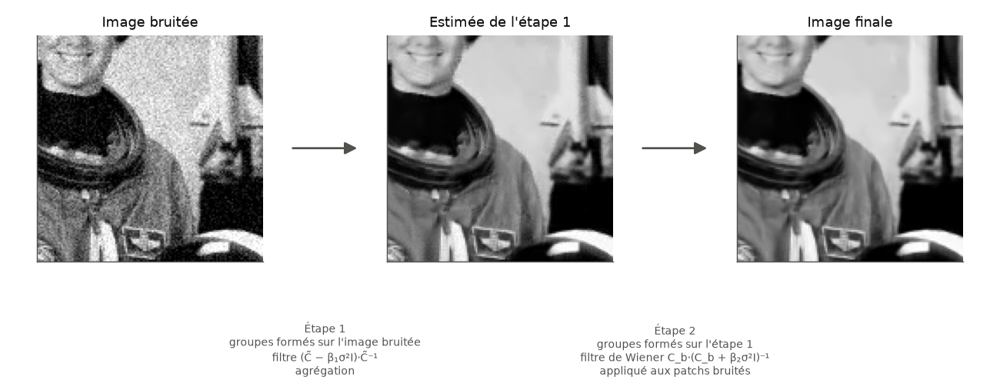
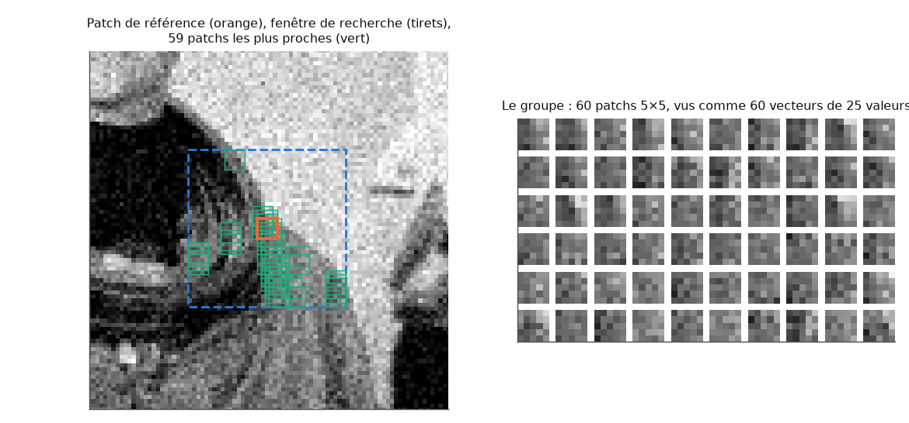
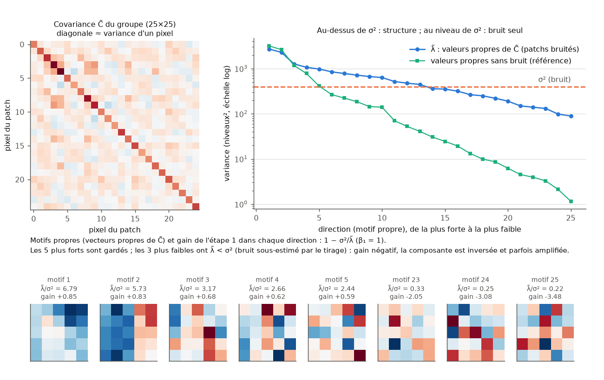
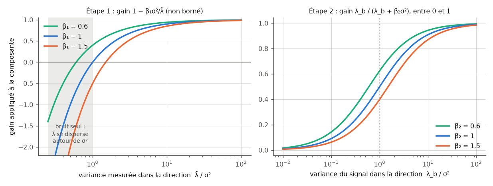

# NL-Bayes : la méthode

## 1. Vue d'ensemble

NL-Bayes débruite une image en deux passes de même structure. Pour chaque
petit carré de l'image (un **patch**), il cherche les patchs qui lui
ressemblent, en déduit un modèle statistique du groupe (une moyenne et une
covariance), et estime chaque patch propre par un **filtre de Wiener**
calculé sur ce modèle. Chaque pixel appartient à plusieurs patchs : ses
estimations sont moyennées.



- **Étape 1** : les groupes sont formés et le modèle est estimé sur
  l'image bruitée. Le résultat (l'**estimée de base**) est déjà débruité
  mais imparfait.
- **Étape 2** : les groupes sont formés et la covariance est estimée sur
  l'estimée de base, bien plus fiable ; le filtre est appliqué aux patchs
  **bruités d'origine**. L'estimée de base ne sert que de guide.

## 2. Patchs, groupes et distance

**Patch.** Un carré de k × k pixels, vu comme un vecteur de d = k²
valeurs. Avec k = 5, d = 25.

**Distance.** La ressemblance entre deux patchs **P** et **Q** est leur
écart quadratique moyen par pixel :

```
δ(P, Q) = (1/d) · Σᵢ (Pᵢ − Qᵢ)²
```

Deux patchs bruités d'un même signal, de bruits indépendants, sont en
moyenne à δ = 2σ². C'est l'ordre de grandeur des distances dans une zone
plate.

**Groupe.** Autour d'un patch de référence, on cherche dans une
**fenêtre de recherche** de n × n positions (n = 7k dans l'article) les
N patchs les plus proches, référence comprise. Le groupe est l'ensemble
de ces N vecteurs.



**Patchs de référence.** Tous les patchs ne sont pas traités comme
références. Le moteur « boucle » suit l'astuce de l'article : un patch déjà
filtré dans un groupe n'est plus pris comme référence (*paste trick*). Le
moteur vectorisé prend une référence tous les `step` pixels (3 par défaut,
[§9](parametres.md#9-les-deux-moteurs)). Dans les deux cas, tous les patchs d'un groupe reçoivent une
estimation, et chaque pixel en reçoit plusieurs.

## 3. La covariance d'un groupe

### 3.1 Définition

Soit un groupe de N patchs bruités **Q̃**₁ … **Q̃**_N (vecteurs de d
valeurs). Sa **moyenne** et sa **covariance** sont :

```
μ = (1/N) · Σⱼ Q̃ⱼ                                  vecteur de d valeurs : le patch moyen
C̃ = 1/(N−1) · Σⱼ (Q̃ⱼ − μ)(Q̃ⱼ − μ)ᵀ                matrice d × d
```

L'élément C̃[i, l] mesure comment les pixels i et l du patch varient
**ensemble** d'un patch du groupe à l'autre :

- sur la **diagonale**, C̃[i, i] est la variance du pixel i dans le
  groupe ;
- **hors diagonale**, C̃[i, l] > 0 si les deux pixels montent et
  descendent ensemble (même côté d'un contour), < 0 s'ils varient en sens
  opposé, ≈ 0 s'ils sont indépendants.

La covariance résume donc la **forme** des variations à l'intérieur du
groupe : un contour, une texture orientée, un dégradé laissent chacun une
signature propre.

### 3.2 Motifs propres

Une covariance est symétrique : elle se diagonalise dans une base
orthonormée,

```
C̃ = V · Λ · Vᵀ          V = [v₁ … v_d] : motifs propres      Λ = diag(λ₁ ≥ … ≥ λ_d)
```

Chaque vecteur propre v_m est un **motif** de k × k pixels, et sa valeur
propre λ_m est la variance du groupe le long de ce motif : de combien les
patchs du groupe s'écartent du patch moyen « dans la forme v_m ». Les
motifs sont rangés du plus fort au plus faible. Le signal d'un groupe
cohérent se concentre dans quelques motifs ; les autres ne contiennent que
du bruit.

### 3.3 Ce que le bruit ajoute

Un bruit blanc de variance σ², indépendant du signal, ajoute **σ²·I** à la
covariance :

```
C̃ = C_s + σ²·I          C_s : covariance du signal seul
```

σ²·I ne change pas les motifs propres et ajoute σ² à chaque valeur
propre : λ̃_m = λ_s,m + σ². Une direction sans signal a donc une variance
σ², une direction de vraie structure une variance nettement supérieure.
C'est ce qui permet de séparer les deux.

### 3.4 Estimer une covariance avec peu de patchs

La covariance est **estimée** sur N patchs seulement, pour d² / 2
inconnues. Deux conséquences :

- **N doit dépasser d**, sinon C̃ n'est pas inversible. D'où la règle de
  l'article : N = 30, 60, 90 pour k = 3, 5, 7 (d = 9, 25, 49).
- **Les valeurs propres du bruit se dispersent.** Même pour un bruit pur,
  les λ̃ estimés ne valent pas tous σ² : ils s'étalent approximativement
  entre σ²(1 − √(d/N))² et σ²(1 + √(d/N))² (loi de Marchenko-Pastur).
  Avec k = 5 et N = 60, de 0,13σ² à 2,7σ² ; avec k = 3 et N = 30, de
  0,20σ² à 2,4σ². Un motif de bruit peut donc paraître plus fort que σ²
  (il est gardé, §4) ou bien plus faible (son gain devient négatif à
  l'étape 1, §4.3).



Sur cet exemple (σ = 20, k = 5, N = 60), les cinq premiers motifs portent
la structure (contour du scaphandre) ; les valeurs propres de la
référence sans bruit (vert) chutent sous σ² dès le sixième motif, alors
que celles des patchs bruités (bleu) restent autour de σ², dispersées de
0,2σ² à 1,1σ² environ.

## 4. L'estimateur : le filtre de Wiener

### 4.1 Le problème

On observe **Q̃** = **Q** + **n**, et l'on suppose :

- le patch propre **Q** gaussien, de moyenne μ et de covariance C_s
  (modèle du groupe) ;
- le bruit **n** gaussien, de moyenne nulle et de covariance σ²·I,
  indépendant de **Q**.

**Q** et **Q̃** sont alors conjointement gaussiens, avec
Cov(**Q**, **Q̃**) = C_s et Var(**Q̃**) = C_s + σ²·I. La meilleure
estimation de **Q** au sens de l'erreur quadratique moyenne (qui est aussi
la plus probable, le MAP, puisque tout est gaussien) est l'espérance
conditionnelle :

```
Q̂ = E[Q | Q̃] = μ + C_s · (C_s + σ²·I)⁻¹ · (Q̃ − μ)
```

C'est le **filtre de Wiener** : il part du patch moyen du groupe et y
rajoute une part de l'écart observé, d'autant plus grande que cet écart
ressemble à du signal.

### 4.2 Lecture dans la base des motifs

Dans la base propre de C_s, la matrice du filtre est diagonale. Chaque
composante de l'écart, c_m = v_mᵀ(**Q̃** − μ), est multipliée par :

```
g_m = λ_s,m / (λ_s,m + σ²)
```

- motif fort (λ_s,m ≫ σ²) : g_m ≈ 1, la composante est gardée ;
- motif faible (λ_s,m ≪ σ²) : g_m ≈ 0, elle est effacée ;
- λ_s,m = σ² : g_m = 1/2.

Le filtre est donc un **seuillage doux, motif par motif**, réglé par le
rapport signal sur bruit de chaque motif. σ² fixe la frontière entre ce
qui est gardé et ce qui est effacé.

### 4.3 Étape 1 : la covariance du signal est inconnue

À l'étape 1, on ne dispose que de C̃, mesurée sur les patchs bruités. Par
§3.3, C_s ≈ C̃ − σ²·I, et C_s + σ²·I ≈ C̃. Le filtre devient (formule 12
de l'article) :

```
Q̂ = μ + (C̃ − β₁·σ²·I) · C̃⁻¹ · (Q̃ − μ)            gain par motif : g_m = 1 − β₁·σ² / λ̃_m
```

β₁ (1 dans l'article) multiplie la variance de bruit retirée. Ce gain
**n'est pas borné** : quand la dispersion d'estimation (§3.4) donne
λ̃_m < β₁σ², g_m est négatif, et la composante est inversée, voire
amplifiée (g = −3,5 pour λ̃ = 0,22σ² dans l'exemple ci-dessus). L'étape 2
rattrape ce défaut : un essai avec le gain borné à [0, 1] ne change le
résultat final que de −0,04 à +0,26 dB, 0,1 dB au plus en moyenne
([§11.9](etudes.md#119-gain-de-létape-1-borné)).

### 4.4 Étape 2 : la covariance vient de l'estimée de base

À l'étape 2, la covariance C_b est calculée sur les patchs de l'estimée
de base, aux mêmes positions que le groupe : elle approche C_s bien mieux
que C̃ − σ²·I. La moyenne μ reste celle des patchs bruités, et le filtre
est appliqué aux patchs **bruités** (formule 15 de l'article) :

```
Q̂ = μ + C_b · (C_b + β₂·σ²·I)⁻¹ · (Q̃ − μ)          gain par motif : g_m = λ_b,m / (λ_b,m + β₂·σ²)
```

Ce gain est toujours compris entre 0 et 1. β₂ vaut 1,2 dans l'article
pour σ < 50 : le filtre suppose un bruit un peu plus fort que σ², ce qui
compense en partie la covariance trop faible de l'estimée de base, déjà
lissée.

### 4.5 Ce que fait β

**β·σ² est la variance de bruit que suppose le filtre.** β > 1 : le filtre
croit le bruit plus fort et efface davantage ; β < 1 : il garde davantage.
Les deux étapes ont chacune leur β parce que ce sont deux filtres
différents (soustraction du bruit d'une covariance bruitée, puis
régularisation d'une covariance presque propre).



### 4.6 Agrégation

Chaque pixel reçoit une estimation de chaque patch filtré qui le
contient. L'image est la moyenne de ces estimations, sans pondération.
L'agrégation réduit encore le bruit et atténue les artefacts de bord de
patch.

## 5. Les deux étapes en détail

### 5.1 Étape 1

Pour chaque patch de référence (patchs k₁ × k₁) :

1. distances δ à tous les patchs de la fenêtre n₁ × n₁, calculées sur
   l'**image bruitée** ;
2. groupe = les N₁ plus proches ;
3. **critère des zones homogènes** (`use_area1`, §5.3) ; s'il est
   satisfait, tous les patchs du groupe prennent la valeur moyenne ;
4. sinon, filtre de l'étape 1 (§4.3) appliqué à tous les patchs du
   groupe ;
5. agrégation : estimée de base.

### 5.2 Étape 2 et seuil τ₀

Pour chaque patch de référence (patchs k₂ × k₂) :

1. distances δ calculées sur l'**estimée de base** ;
2. le groupe n'a plus une taille fixe :

   ```
   d_N = distance du N₂-ième patch le plus proche
   τ   = max(τ₀, d_N)
   groupe = tous les patchs de la fenêtre à distance ≤ τ
   ```

   Sans τ₀, le groupe compte N₂ patchs. τ₀ est un **plancher de
   ressemblance** : dans une zone plate de l'estimée de base, beaucoup plus
   de N₂ patchs sont presque identiques, et τ₀ permet de tous les prendre
   (moyenne et covariance mieux estimées) ;
3. critère des zones homogènes (`use_area2`, désactivé dans l'article) ;
4. filtre de Wiener (§4.4) appliqué aux patchs bruités du groupe ;
5. agrégation : image finale.

τ₀ est un seuil **absolu**, en niveaux² sur l'échelle 0-255 (4 dans
l'article, soit 2 niveaux d'écart moyen). Il ne dépend pas de σ : son
effet relatif change avec le niveau de bruit et avec l'échelle ([§7.2](parametres.md#72-léchelle-0-255)).
Comme les distances sont mesurées sur l'estimée de base, dont le bruit
résiduel est faible, τ₀ ne joue que dans les zones à peu près plates.

### 5.3 Critère des zones homogènes

```
s² = variance de toutes les valeurs de pixels du groupe (N × d valeurs)
si  s² ≤ (γ·σ)²   alors   chaque patch du groupe = moyenne scalaire de ces valeurs
```

Si la dispersion du groupe ne dépasse pas celle du bruit, le groupe est
jugé plat et remplacé par sa moyenne : un débruitage maximal, sans
estimer de covariance. γ = 1,05 dans l'article. Le critère est évalué sur
le groupe bruité, aux deux étapes. C'est **le** paramètre des aplats et
des zones sombres ([§11.5](etudes.md#115-sensibilité-rgb-démosaïqué-zones-sombres)).
