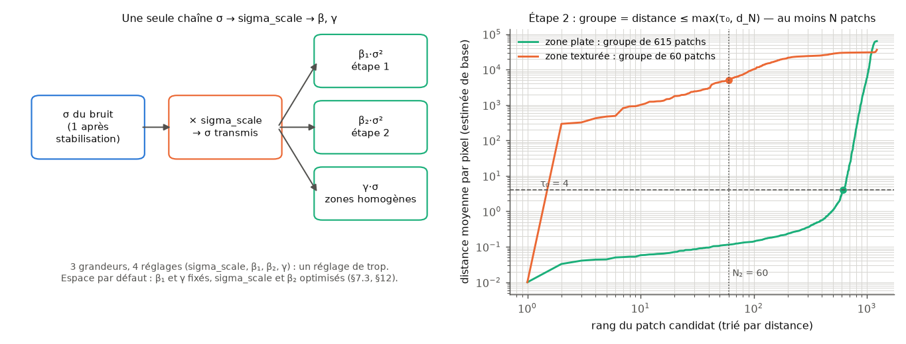
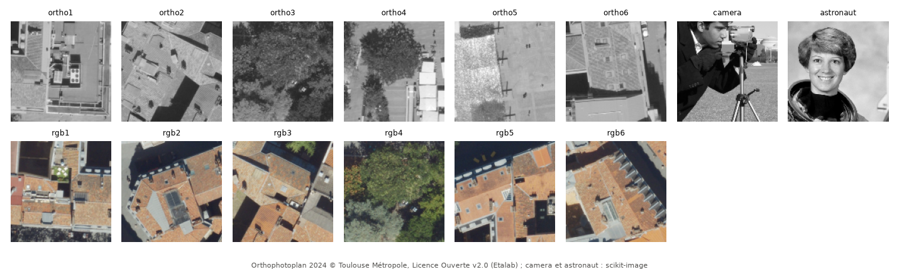

# NL-Bayes : paramètres, σ, couleur, moteurs

## 6. Les paramètres

### 6.1 Liste complète

| Rôle | `nl_bayes` (argument) | Article | Où il intervient | Effet |
|---|---|---|---|---|
| Niveau de bruit | `sigma` (+ `sigma_scale` en optimisation) | — | β·σ² dans les deux filtres, γσ dans le critère homogène, choix des valeurs par défaut (§6.2) | §7 |
| Dynamique | `data_range` | — | conversion vers l'échelle 0-255 (§7.2) | aucun sur les filtres ; fixe l'échelle de τ₀ et des paliers |
| Taille des patchs | `k1`, `k2` | 5 (gris, σ < 50), 3 (couleur, σ < 20) | dimension d = k² du modèle | petit : peu de structure, groupes plus semblables ; grand : covariance d × d mal estimée |
| Patchs par groupe | `N1`, `N2` | 30 / 60 / 90 pour k = 3 / 5 / 7 | estimation de μ et C ; étape 2 : minimum avant τ₀ | petit : covariance bruitée ([§3.4](methode.md#34-estimer-une-covariance-avec-peu-de-patchs)) ; grand : patchs moins semblables |
| Fenêtre de recherche | `n1`, `n2`, ou `window_factor` α (n = α·k) | α = 7 | candidats au groupe | petit : groupes pauvres ; grand : plus lent |
| Atténuation, étape 1 | `beta1` | 1,0 | C̃ − β₁σ²I | > 1 : lisse plus ; < 1 : garde plus |
| Atténuation, étape 2 | `beta2` | 1,2 (σ < 50), 1,0 au-delà | C_b + β₂σ²I | idem |
| Seuil homogène | `gamma` | 1,05 | s² ≤ (γσ)² | grand : aplats lissés, petits détails perdus |
| Critère homogène | `use_area1`, `use_area2` | oui / non | [§5.3](methode.md#53-critère-des-zones-homogènes), par étape | [§11.5](etudes.md#115-sensibilité-rgb-démosaïqué-zones-sombres) |
| Plancher de similarité | `tau0` | 4 niveaux² | τ = max(τ₀, d_N), étape 2 | 0 : groupes limités à N₂ ; grand : patchs dissemblables agrégés |
| Couleur | `color_mode` | `yuv` | §8 | — |
| Pas des références | `step` (moteur vectorisé) | — (astuce « paste ») | nombre de groupes traités | 2 : +0,06 dB, 2× plus lent ; 4 : −0,03 dB, 1,6× plus rapide |
| Exécution | `engine`, `chunk`, `n_threads` | — | moteur et parallélisme | aucun sur le résultat (sauf `engine`, §9) |
| Étape 1 seule | `return_basic` | — | renvoie l'estimée de base | — |

### 6.2 Les valeurs de l'article et σ

L'article donne des **valeurs conseillées** selon σ, sur l'échelle 0-255
(tableau récapitulatif [§4.8](methode.md)) : patchs de 3 en couleur jusqu'à σ = 20, de
5 jusqu'à 50, de 7 au-delà ; β₂ = 1,2 sous σ = 50. Ce sont des conseils
établis pour des bruits **forts** : σ = 20 représente 8 % de la
dynamique, un rapport signal sur bruit d'environ 12 en pleine échelle.

En télédétection, σ vaut plutôt 1 à 5 sur 255. Les paliers ne servent
alors jamais : on reste dans la première colonne, réglée pour un bruit
4 à 20 fois plus fort. Les études du [§11](etudes.md#11-études) mesurent ce que deviennent ces
réglages à faible bruit.

**Dans ce module**, `nl_bayes_parameters` applique ces paliers
automatiquement aux paramètres non fournis. C'est une commodité, pas une
règle de la méthode. Deux précautions :

- en optimisation, un paramètre laissé à son palier (β₂ notamment)
  **saute** quand `sigma_scale` fait passer σ de part et d'autre d'un
  seuil (β₂ passe de 1,2 à 1,0 à σ = 50) : la fonction optimisée devient
  discontinue. Fixer explicitement les paramètres non optimisés ;
- pour une série d'images, fixer explicitement k, N et β plutôt que de
  dépendre de σ estimé image par image.

### 6.3 Dépendances entre paramètres

Appliquées par `resolve_parameters` quand un paramètre est changé seul :

- **N suit k** : N = 30 / 60 / 90 pour k = 3 / 5 / 7, et toujours
  N ≥ k² + 1 (covariance inversible) ;
- **n suit k** : n = α·k (`window_factor` α) ;
- **σ, β et γ agissent ensemble** (§7.3).

## 7. σ dans NL-Bayes

Les généralités sur σ (ce qu'il représente, son estimation, le modèle de
bruit du capteur, la stabilisation de variance, le facteur C après
démosaïçage) sont communes à toutes les méthodes : [référence technique](../reference.md)
[§4](methode.md#4-lestimateur--le-filtre-de-wiener) à §6. Ce chapitre ne garde que ce qui est propre à NL-Bayes.

### 7.1 Où σ intervient

À trois endroits seulement, et toujours multiplié par un autre
paramètre :

| Usage | Expression | Étape |
|---|---|---|
| variance de bruit retirée à la covariance | β₁·σ² | 1 |
| variance de bruit du filtre de Wiener | β₂·σ² | 2 |
| seuil du critère des zones homogènes | γ·σ | 1, 2 (si actif) |

S'y ajoute le choix des valeurs par défaut (§6.2), qui n'est pas un usage
dans le calcul. Les distances δ, τ₀ et l'agrégation n'en dépendent pas.

**Le même σ sert aux deux étapes.** C'est correct : les filtres
s'appliquent aux patchs bruités d'origine, dont le bruit vaut σ ; l'estimée
de base ne sert qu'à former les groupes et à estimer C_b.

### 7.2 L'échelle 0-255

σ est fourni dans les unités de l'image, puis converti, avec l'image, sur
l'échelle 0-255 par `data_range` (par défaut le min/max de l'image). Le
calcul reste en flottants : ce n'est pas une quantification 8 bits, mais
le moyen d'appliquer τ₀ et les paliers de l'article, exprimés sur cette
échelle. Les filtres eux-mêmes ne dépendent pas de l'échelle.

Conséquence : « σ = 20 » dans l'article signifie « σ = 20/255 de la
dynamique ». Avec le min/max par défaut, une image peu contrastée voit son
σ relatif gonflé ; pour une série d'images, fixer `data_range` à la
dynamique du capteur (par exemple `(0, 4095)`).

Après stabilisation de variance, σ vaut 1 (ou C) dans le domaine
transformé, dont la dynamique est d'environ 2·√(crête en e⁻) : σ ≈ 13 sur
l'échelle de l'article à 100 e⁻ en crête, 1,3 à 10 000 e⁻.

### 7.3 Redondance entre σ, β et γ

Le calcul ne dépend que des produits β₁σ², β₂σ² et γσ : **trois
grandeurs**. Les réglages qui les modifient sont au nombre de **quatre**
(`sigma_scale` = s, β₁, β₂, γ) : multiplier σ par s revient exactement à
multiplier β₁ et β₂ par s² et γ par s (même image au bit près, vérifié sur
le moteur natif à tailles de patch fixées). **Un réglage est de trop, et
un seul** : il faut en figer un, pas tous.

Figer γ, comme le fait l'espace par défaut, laisse trois réglages
indépendants : s (niveau global, et seul à déplacer γσ), β₁ et β₂ (niveau
relatif de chaque étape). Ce que valent β₁ et β₂ en plus de s est mesuré
au [§11.4](etudes.md#114-sensibilité-niveaux-de-gris-images-texturées) et au [§11.5](etudes.md#115-sensibilité-rgb-démosaïqué-zones-sombres) : peu.

Sans critère homogène (γ absent ou inactif), il ne reste que deux
grandeurs (β₁σ², β₂σ²) : s et un seul β suffisent.

*À gauche : une seule chaîne σ → `sigma_scale` → β₁σ², β₂σ², γσ. À
droite : à l'étape 2, le groupe contient les patchs à distance
≤ max(τ₀, d_N) — exactement N₂ dans une zone texturée, bien plus dans une
zone plate (ici 615 pour N₂ = 60). Figure : `examples/nl_bayes_figures.py`.*

`optimize_parameters` avertit si un espace de recherche laisse libres
ensemble `sigma_scale`, β₁, β₂ et γ (ou `sigma_scale`, β₁ et β₂ quand le
critère des zones homogènes est désactivé aux deux étapes).

## 8. Couleur et images démosaïquées

### 8.1 Trois traitements de la couleur

`color_mode`, pour une image (H, W, 3) de même σ sur les trois canaux :

- **`"yuv"`** (défaut, choix de l'article, §3.3-3.4 et tableau 8) :
  étape 1 dans l'espace Y₀U₀V₀ rendu orthonormé (σ conservé sur chaque
  canal transformé), groupes formés sur Y₀ seul et appliqués à U₀ et V₀,
  filtrage canal par canal ; étape 2 en RGB, groupes formés sur la distance
  moyenne des trois canaux de l'estimée de base (formule 13), **canaux
  filtrés ensemble** : patchs de 3k² valeurs et covariance commune
  (tableau 1 de l'article : deux groupes 3D en tout à l'étape 2, contre deux
  par canal pour BM3D) ;
- **`"rgb"`** : les deux étapes en RGB, groupes communs aux trois canaux,
  étape 2 à canaux filtrés ensemble ;
- **`"channel"`** : chaque canal débruité indépendamment, comme une image
  en niveaux de gris.

Valeurs par défaut : tableau [§4.8](methode.md) de l'article (patchs de 3 sous σ = 20)
pour `"yuv"` et `"rgb"`, profil niveaux de gris pour `"channel"`.

### 8.2 Image démosaïquée

Le démosaïçage corrèle le bruit entre pixels voisins et entre canaux, et
change sa variance en luminance d'un facteur κ_Y propre au démosaïqueur.
La recette générale (stabiliser avec le modèle du capteur, débruiter avec
σ = C = √κ_Y + 0,2, inverser) est décrite dans [référence technique](../reference.md)
§6 et eoqual-demosaicing ([§11.3](etudes.md#113-τ₀--une-règle-fonction-de-σ-testée-et-écartée)).

Ce qui est propre à NL-Bayes : le modèle suppose un bruit **blanc**,
σ²·I. Un bruit corrélé a une covariance Σ_n qui n'est pas diagonale ; il
est fort dans les motifs lisses (basses fréquences) et faible dans les
motifs fins. Retirer σ²·I partout efface trop le grain fin et pas assez
les taches. L'étude du [§11.5](etudes.md#115-sensibilité-rgb-démosaïqué-zones-sombres) le mesure : après Hamilton-Adams, le bruit
démosaïqué est corrélé à 0,4 entre voisins en R et B, et dans les zones
sombres l'erreur de basse fréquence ne diminue presque pas au-delà de
1 500 e⁻, alors que le grain fin diminue. La piste naturelle est de
remplacer σ²·I par Σ_n dans les deux filtres ([§14](limites.md#14-limites-et-pistes)), ou
revenir à la mosaïque, où le bruit est blanc (`nl_bayes_cfa`, [§13](cfa.md#13-nl_bayes_cfa--débruiter-et-démosaïquer-depuis-la-mosaïque)).

## 9. Les deux moteurs

- **`engine="vectorized"`** (défaut) : références sur une **grille** de
  pas `step` (3 par défaut) au lieu de l'astuce « paste », qui est
  séquentielle par nature. Pour un lot de références : extraction des
  fenêtres, distances, sélection des voisins, une matrice de filtrage
  d × d par groupe (A = I − β₁σ²C̃⁻¹ à l'étape 1, A = C_b(C_b + β₂σ²I)⁻¹ à
  l'étape 2) appliquée à tout le groupe par un seul produit, agrégation
  restreinte aux positions touchées. À l'étape 2, les groupes sont traités
  par paquets de taille voisine (médiane 60, jusqu'à la fenêtre entière
  dans les aplats). Les lots sont répartis sur `n_threads` fils
  (min(cœurs, 8) par défaut ; résultat indépendant du nombre de fils).
- **`engine="loop"`** : version fidèle à l'article (astuce « paste »),
  niveaux de gris ou couleur canal par canal.

**Choix non fixés par l'article** (les deux moteurs) : fenêtre de
recherche rabattue à l'intérieur de l'image près des bords ; covariance de
l'étape 2 centrée sur la moyenne des patchs de l'estimée de base ; critère
homogène de l'étape 2 évalué sur le groupe bruité ; covariance singulière
→ patchs laissés inchangés (remarque [§3.3](methode.md#33-ce-que-le-bruit-ajoute) de l'article) ; calcul en
flottants, sans quantification.

**Face à l'exécutable IPOL** (`nl_bayes_ipol`) : à égalité sur 256 × 256
(±0,1 dB), +0,1 à +0,4 dB sur 512 × 256 en niveaux de gris. L'exécutable
IPOL 2013 ne permet pas de régler les paramètres en ligne de commande
(il n'applique pas les patchs de 5 conseillés en gris) et quantifie
l'image sur 8 bits pour l'échange (PNG).

## 10. Jeux de données

| Jeu | Contenu | Bruit | Utilisé par |
|---|---|---|---|
| **Benchmark** | moitié droite (512 × 256) d'« astronaut » (NASA, domaine public), gris et RGB | blanc gaussien σ = 0,05 / 0,1 / 0,2 (image dans [0, 1]), graine 2 | `examples/nl_bayes_benchmark.py`, [§11.1](etudes.md#111-moteurs-benchmark-niveaux-de-gris-psnr-en-db)-11.2 |
| **τ₀, ajustement** | camera, astronaut, coffee, brick, grass, moon (scikit-image), recadrées à 256 × 256 au plus | gris σ = 5 à 60 ; poisson-gaussien 5 à 400 e⁻ (stabilisé) | `examples/tau0_study.py --images fit`, [§11.3](etudes.md#113-τ₀--une-règle-fonction-de-σ-testée-et-écartée) |
| **τ₀, validation** | coins, gravel, rocket, chelsea, text (scikit-image), autre tirage | idem, plus couleur `yuv` σ = 10 à 40 | `examples/tau0_study.py --images validation`, [§11.3](etudes.md#113-τ₀--une-règle-fonction-de-σ-testée-et-écartée) |
| **Orthophoto, gris** | 6 tuiles 128 × 128 de luminance, pixels de 20 cm, choisies parmi les plus texturées (toitures en tuiles, frondaisons, dallage) ; plus camera et astronaut sous-échantillonnées, pour comparaison | blanc gaussien σ = 2, 5, 10, 20 (échelle 0-255), 2 tirages | `examples/nl_bayes_sensitivity.py --parts gray`, [§11.4](etudes.md#114-sensibilité-niveaux-de-gris-images-texturées) |
| **Orthophoto, RGB démosaïqué** | 6 tuiles RGB 128 × 128 texturées avec 20 à 30 % de zones sombres (ombres portées) | chaîne capteur simulée, ci-dessous | `examples/nl_bayes_sensitivity.py --parts rgb`, [§11.5](etudes.md#115-sensibilité-rgb-démosaïqué-zones-sombres) |

**Orthophoto.** Extrait « place du Capitole » de l'Orthophotoplan 2024 de
Toulouse Métropole (Licence Ouverte v2.0, Etalab), le même que l'exemple
d'eoqual-resampling : 4 096 × 4 096 pixels de 5 cm, moyennés 4 × 4. La
moyenne réduit le bruit propre de l'orthophoto (environ 2 à 6 niveaux
résiduels estimés) et donne des pixels de 20 cm. Ces images sont **plus
texturées** que les images classiques : l'énergie de leurs détails fins
(écart-type du laplacien) vaut 31 à 42, contre 53 à 63 pour camera et
astronaut sous-échantillonnées, mais répartie partout dans l'image au lieu
de quelques contours nets.

**Chaîne capteur simulée (volet RGB).**

1. Image linéaire : l'orthophoto (codée pour l'affichage) est ramenée en
   flux par la puissance 2,2, puis mise à l'échelle d'un flux crête de
   300, 1 500 ou 7 500 e⁻ ; les zones d'ombre deviennent des zones à
   faible signal.
2. Mosaïque de Bayer RGGB : une seule couleur par pixel.
3. Bruit : Poisson (photons) plus bruit de lecture gaussien de 3 e⁻ ;
   gain 1 e⁻/DN.
4. Démosaïçage Hamilton-Adams (eoqual-demosaicing), κ_Y = 1,35, d'où
   C = √1,35 + 0,2 = 1,36.
5. Débruitage NL-Bayes couleur, de deux façons : **avec stabilisation**
   (transformée d'Anscombe généralisée avec le vrai modèle, σ = C, inverse
   exacte) ou **avec un σ global** (σ = C·√(lecture² + signal moyen)).
6. Référence : le démosaïçage de la mosaïque **sans bruit**. Le débruiteur
   ne peut pas corriger l'erreur d'interpolation du démosaïqueur ; comparer
   à l'image RGB vraie la mélangerait au bruit.
7. Mesures dans le **domaine d'affichage** (gamma 1/2,2 sur 0-255), où le
   bruit des zones sombres est visible : écart quadratique moyen de
   l'erreur en **luminance** (moyenne des trois canaux) et en **couleur**
   (écart de chaque canal à cette moyenne), séparément dans les zones
   **sombres** (luminance de référence < 60) et **claires** (> 120), plus
   le PSNR de l'image linéaire.

Point de départ des études : les valeurs de l'article dans leur première
colonne (gris : k = 5, N = 60 ; couleur : k = 3, N = 30 ; α = 7, β₁ = 1,
β₂ = 1,2, γ = 1,05, τ₀ = 4, critère homogène à l'étape 1 seulement),
appliquées partout, sans palier.
